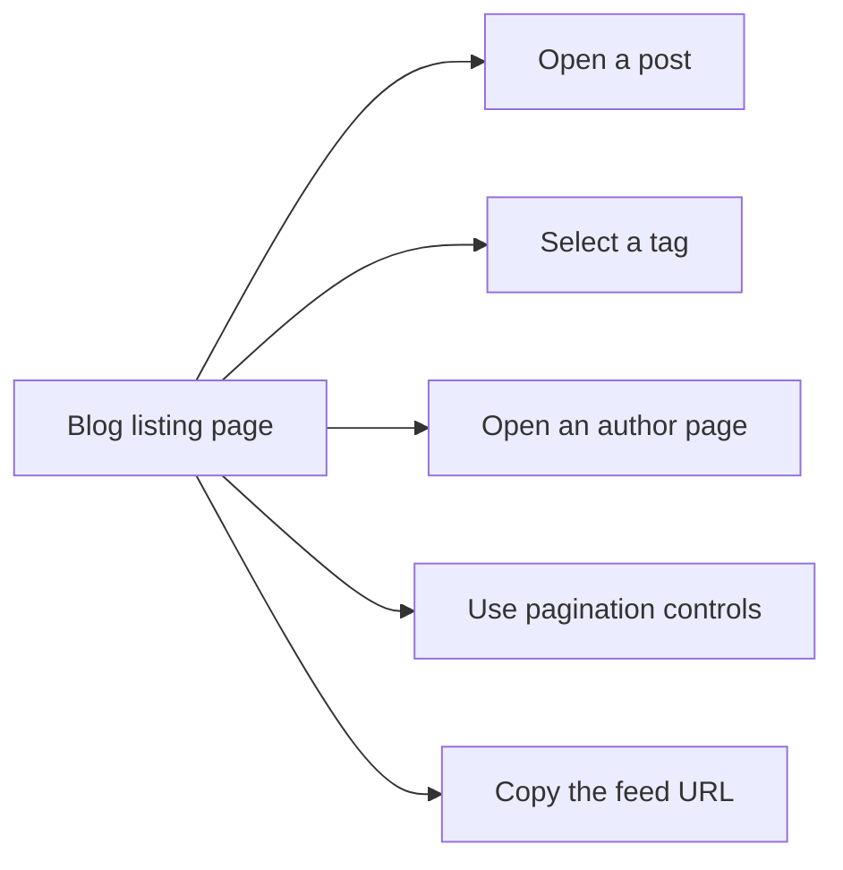

# Blog

Blog is the publishing space where content authors share articles and readers find, read, and follow updates. It is for two main audiences:

- **Blog readers** who want to discover posts, read full articles, and stay current through feeds.
- **Content authors** who publish new posts and make them easy to find by author and topic.

## What you can do with blog

Blog brings together reading, discovery, and publishing in one place.

- Read posts from the blog listing page
- Open a post to view its full content
- Browse posts by a specific author
- Filter posts by tags
- Move through older and newer posts with pagination
- Subscribe to updates through an RSS or Atom feed

Figure: Blog reader journey

## Reading and discovery

When you visit the blog listing page, you see posts arranged with pagination so you can move through the full archive without opening a separate search page. Each post links to its full article.

Tags and authors are the main discovery tools. A tag page groups posts around a shared topic, while an author page shows everything written by one person. You can reach both from the listing page and from individual posts.

## Publishing and visibility

Content authors can publish a new blog post and associate it with an author and tags. Once published, the post appears in the normal reading experience: on the blog listing page, on the matching tag pages, on the author's page, and in the blog feed.

This means readers can discover the post through multiple paths, and subscribers receive it automatically when their feed reader checks for updates.

## Key options and limits

- **Authors** group posts by writer and give readers a way to follow a favorite contributor.
- **Tags** group posts by topic and support topic-based filtering.
- **Pagination** keeps the blog listing manageable as the archive grows.
- **RSS or Atom feeds** let readers receive updates in a feed reader rather than checking the blog manually.

The reference material available for this documentation did not include Blog-specific implementation files, so options such as drafts, scheduled publishing, or feed customization are not described here.

## Related pages

- [How to read blog posts](doc:57233a51-0950-4196-9956-3b00feba6ea8)
- [How to filter posts by tags](doc:75e2bdb6-cfa0-43ca-af94-ad73e000b116)
- [How to browse posts by author](doc:eb398d91-e19b-44d1-919b-8867d52ca3e7)
- [How to paginate through blog listing](doc:b730bfae-beb9-44ee-bdd4-d054a010e1fe)
- [How to publish a new blog post](doc:e6f2b8c1-5128-4000-b860-496e2e1c19cd)
- [How to subscribe to RSS/Atom feed](doc:a4e80361-f5d0-4fd9-bf8a-131d64f8dec9)
