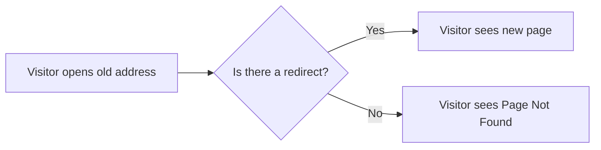

# Client-Side redirects

Client-side redirects help site administrators and maintainers keep web addresses working when pages move, change names, or are retired. When a visitor opens an old address, the redirect sends them to the correct page automatically. This preserves bookmarks, keeps shared links working, and protects search visibility.

## Who this is for

This feature is for site administrators and maintainers who:

- rename or reorganize pages
- move content from one address to another
- retire old addresses but want visitors sent to the right place
- inherit links from a previous site structure

## What it enables

| Outcome | What it means for your site |
| --- | --- |
| Moved and renamed pages stay reachable | Visitors following an old link land on the current page instead of seeing a **Page Not Found** error |
| Bookmarks keep working | Saved links continue to open the renamed page |
| Search continuity | Search engines and directory listings pointing at an old address reach the replacement content |
| Legacy addresses resolve | Outdated links from past site structures forward to a current destination |

## How a redirect behaves

When a visitor opens an old address, the redirect checks for an available new address and takes them there. If no redirect exists, the visitor sees a **Page Not Found** message.

Figure: How a client-side redirect responds to a visitor

The redirect happens in the visitor's browser, so no extra action is needed from the person following the old link.

## Common redirect scenarios

Three typical situations call for a client-side redirect:

1. **A page was renamed**, the old address forwards to the renamed page with the same content.
2. **A page was moved to a new section**, the previous address points to the content in its new location.
3. **A broken or legacy link is discovered**, an outdated address is mapped to the most relevant current page.

## What is available in this product

The current version of this product is a personal code snippet library. Its visible screens manage saved snippets, favorites, categories, languages, and tags, there are no redirect management controls for creating, editing, or removing site addresses.

If you manage a documentation site or blog that supports redirects, the following guides describe the related workflows:

- [Handle page renames without 404s](doc:f18ab05d-bacf-435c-9718-72d562f08b71)
- [Redirect broken or legacy URLs](doc:9c930e9c-1ecc-47be-bb49-d0492e4efdb2)
- [Generate redirect pages at build time](doc:ab189fd8-aaac-4fd8-ac20-d0370b1800ac)
