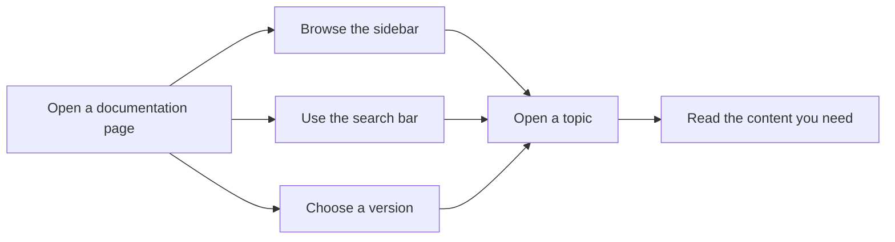
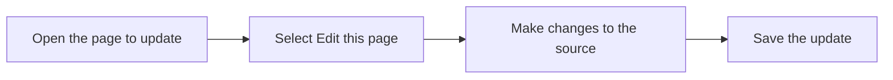

# Documentation

Documentation gives site visitors a clear, organized way to read and explore written content, and it gives content authors a simple path to keep that content accurate and up to date.

## What documentation is

Documentation is the reading and authoring experience for a written content site. It turns a collection of pages into a navigable library where visitors can browse by topic, search the content, switch between versions, and go directly to the source of a page to update it.

## Who it's for

Documentation serves two main audiences:

- **Site visitors** who need to find and read information quickly
- **Content authors** who create, update, and organize the pages

## Key capabilities

### Sidebar navigation

Visitors browse documentation through a sidebar that groups pages into sections. Each section lists its pages so readers can move between topics without losing their place.

### Versioned documentation sets

Documentation can present multiple versions of the same content. A **Version selector** lets visitors choose the release or edition they want to read.

### Search

A **Search bar** helps visitors locate pages by searching within the documentation content. This is especially useful when the sidebar is long or the reader isn't sure which section a topic lives in.

### Edit links

Each page can include an **Edit this page** link. Selecting it takes a content author directly to the source material for that page, so corrections and updates can be made and saved.

Figure: How site visitors navigate documentation

Figure: How content authors update a page

## Benefits

- **Find information fast** with search and an organized sidebar
- **Read the right version** with a version selector
- **Keep content accurate** with direct edit links for authors
- **Navigate large libraries** without losing context

## Key options and limits

- Versioned sets let visitors switch between documented releases
- The sidebar groups pages by section and can be organized to match the site's structure
- Search covers the documentation content, helping readers locate specific topics
- Edit links connect a page to its source so updates are traceable

## Related

- [Browse documentation by sidebar](doc:685e4cd2-3c7c-4695-b350-e23af2d1f63a)
- [Navigate versioned documentation sets](doc:6a1d800b-42e7-4df1-b553-abf64bee6d1e)
- [Search documentation content](doc:69f7c19d-b889-473d-9232-66d965211c25)
- Edit current page via source link
- [Configure documentation sidebar and paths](doc:2a3a4fec-97fe-4e4e-b14d-a8ed7156eddd)
