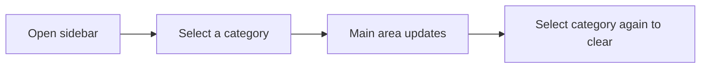
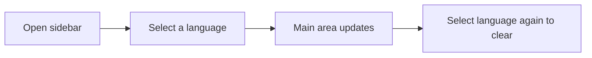
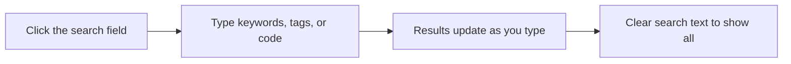

# How to browse posts by author

This guide explains how to find content by a specific author in CodeKnit. The current version does not include author pages or an author filter, and author information is not stored on any saved item.

## Before you start

No prerequisites are needed. You can locate content using the category, language, and search tools described in this guide instead.

## Browse content using available filters

### Browse by category

Figure: Browsing content by category

1. Open CodeKnit.
2. In the sidebar, locate the **Categories** section.
3. Select a category name, such as **Utilities**.
4. The main content area refreshes to show only matching items, and the **shown** count updates.
5. To clear the filter, select the same category again.

### Browse by language

Figure: Browsing content by language

1. Open CodeKnit.
2. In the sidebar, locate the **Languages** section.
3. Select a language, such as **JavaScript**, **Python**, **SQL**, or **Markdown**.
4. The main content area refreshes to show only matching items.
5. To clear the filter, select the same language again.

### Search for specific content

Figure: Searching for content

1. At the top of the content area, click the **Search snippets** field.
2. Type keywords, tags, or code text.
3. Results update as you type.
4. Clear the search text to return to all items.

## Expected result

After selecting a category or language in the sidebar:

- The main content area shows only items matching your selection.
- The **shown** count reflects the filtered list.
- The selected sidebar item appears highlighted as active.

## Common issues

**There is no author page or author filter.** The current version does not store author information on any content item. For updates on Blog features, see the [Blog](doc:f1d57023-8601-4eab-8ceb-1c59a0baae3c) feature page.

**A filter shows no results.** The selected category or language may not match any items in your library. Try a different selection or clear the filter.

**Filters stay active when switching sections.** Category and language filters persist across sidebar sections. Clear them by selecting the active filter again.

## Related

- [How to read blog posts](doc:57233a51-0950-4196-9956-3b00feba6ea8)
- [How to filter posts by tags](doc:75e2bdb6-cfa0-43ca-af94-ad73e000b116)
- [Search and Filtering](doc:d4db354c-9033-416f-babe-aaab07cc3975)
- [Snippet Organization](doc:c88b9d7b-71f1-4365-b228-3a4ca18a9db4)
