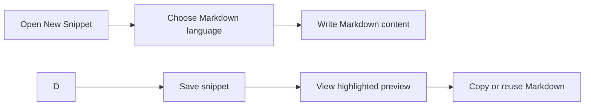

# MDX and markdown authoring

Markdown support in CodeKnit lets you store, edit, and reuse formatted-text content alongside your code snippets. When you write in Markdown, the editor highlights headings, bold text, links, and other formatting elements with distinct colors, so you can see the structure of your document while you work.

## Who it's for

- **Content authors** who draft reusable text such as announcements, instructions, templates, or documentation snippets
- **Developers** who keep Markdown sources, README sections, commit message formats, or doc templates, close at hand

## What you can do

### Write markdown with syntax-aware editing

Choose **Markdown** as the snippet language when you create a new snippet. The editor applies color-coded highlighting to headings, bold text, links, and other Markdown elements as you type. This keeps the source readable and helps you spot formatting mistakes early.

### Preview highlighted markdown

Markdown snippets appear in your library cards and detail view with the same syntax highlighting. You can scan the content quickly without opening a separate tool.

### Copy reusable markdown source

Copy the raw Markdown text with one click from any card or the detail viewer. Paste it directly into a blog post, documentation tool, note-taking app, or README file.

### Organize markdown with the same tools as code

Markdown snippets support the same metadata as code snippets:

- **Title** and **description**
- **Category** for grouping related content
- **Tags** for flexible cross-filtering
- **Mark as favorite** to pin important documents for quick access

### Search and filter markdown content

Use the search bar or the sidebar to narrow your library by Markdown language, category, tag, or query text. Markdown snippets appear alongside JavaScript, Python, and SQL entries, one library for everything you reuse.

Figure: Creating and reusing a Markdown snippet

## Key options when authoring markdown

| Option | What it does |
| --- | --- |
| **Language** | Select **Markdown** from the language picker to get Markdown-specific highlighting |
| **Title** | Required, a short name that identifies the snippet in your library |
| **Description** | Optional, adds context about what the Markdown content is for |
| **Category** | Choose from existing categories or create a custom one |
| **Tags** | Add one or more tags for cross-cutting organization |
| **Mark as favorite** | Pins the snippet to the Favorites section for quick retrieval |

## Limits

- CodeKnit shows Markdown with **syntax highlighting only**, it does not render the formatted document. You see the source text with colors, not the final styled output.
- **MDX format is not supported** in this version. You cannot embed interactive components in Markdown snippets.
- **Front matter validation** is not available. CodeKnit does not validate or parse YAML-style front matter in Markdown content.
- **Image handling** is not automated. Inline image references in Markdown are stored as text; the app does not preview, optimize, or transform images.

## Related

- [Snippet Management](doc:d875ccc9-b2fb-4c86-82a0-190a6952a4c7), create, edit, and organize individual snippets with metadata
- [Code Editing](doc:2cbb8fac-e41c-44bf-93bd-7fc333e72aa0), use the built-in editor with syntax highlighting and tab support
- [Code Preview and Highlighting](doc:1af35ce8-def3-409e-a761-91543f16f3d9), how syntax coloring works across languages
- [Search and Filtering](doc:d4db354c-9033-416f-babe-aaab07cc3975), find Markdown and code snippets by query, language, category, and tag
