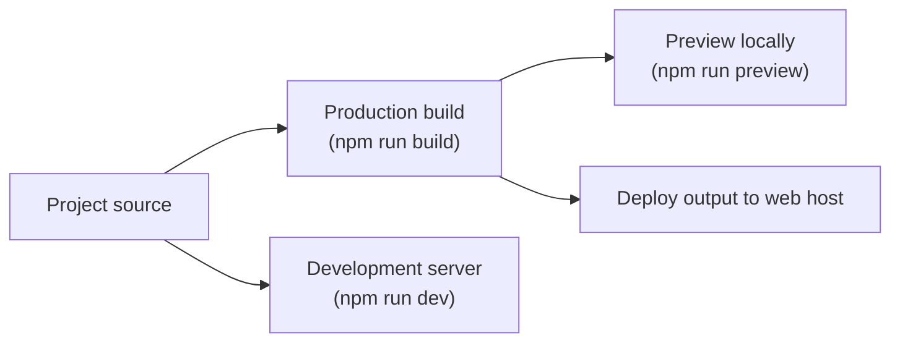

# Site building and bundling

Site Building & Bundling takes the site's source code and compiles it into a production-ready package you can preview locally and then deploy to a web host. It is for developers who maintain the site and site administrators who need to verify a production build before it goes live.

You control the build through npm commands that call Vite. Four commands cover the full cycle from local development to production preview.

| Goal | Command | What it runs |
| --- | --- | --- |
| Build an optimized production bundle |`npm run build` |`vite build` |
| Build a less-optimized development bundle |`npm run build:dev` |`vite build --mode development` |
| Preview a completed production bundle locally |`npm run preview` |`vite preview` |
| Start the local development server |`npm run dev` |`vite dev` |

These commands are defined in the`package.json` files of the project. Each requires Node.js and npm, plus a local copy of the project with dependencies installed.

## How the build and preview cycle fits together

Figure: Site build and preview flow

## Options and limits

- The bundler configuration present in the provided source is controlled through`package.json`: the Vite version, the Rolldown override, and the build scripts. No separate Vite or bundler configuration file is included in the source files reviewed.
- The provided source does not include a Docusaurus configuration or Docusaurus-specific build settings.
- Production builds prioritize performance and smaller file sizes. Development builds keep behavior easier to debug at the cost of larger output.
- Build and preview commands are available to anyone with a local copy of the project and the required Node.js and npm versions installed.

## Related

- [System Requirements and Setup](doc:1ee3382e-2c19-47df-949f-7d74e87568fd)
- [Quick Start Guide](doc:27bdcaf5-0df9-412f-9cd1-5eaf702b8d97)
