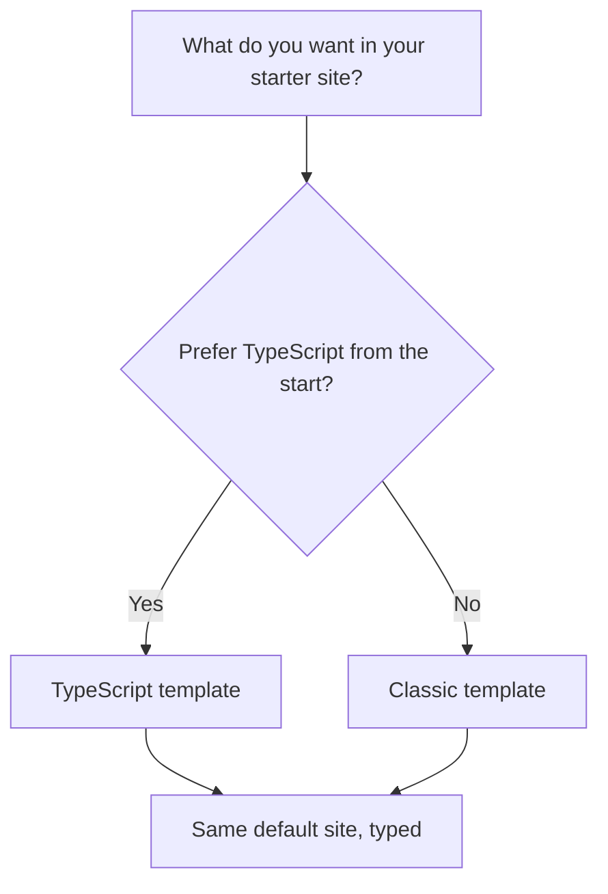
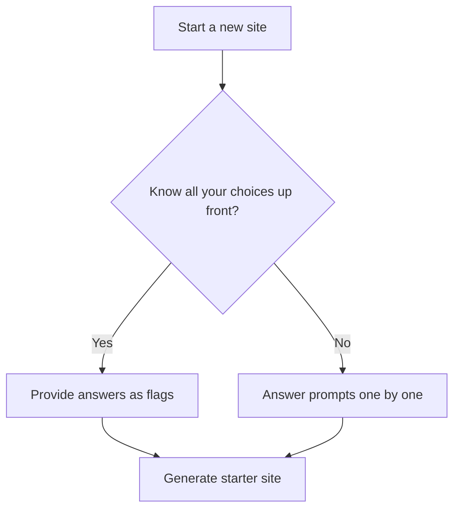

# Site scaffolding

Site Scaffolding is the fastest way to go from an empty folder to a running documentation site. Instead of building navigation, layout, and default pages yourself, you answer a few simple questions and the scaffolding tool creates a complete, working starter site.

## Who it's for

Site Scaffolding is for developers who are starting a new site or evaluating whether the platform fits their needs. It's especially useful when you want a known-good starting point, when you're following a tutorial, or when you need to spin up a new site quickly without making dozens of setup decisions.

## What you can do

Site Scaffolding provides four main capabilities.

### Create a new site from scratch

You start a new site with a single scaffolding command, then answer the prompts the tool needs, such as what to name the site. The tool handles the folder creation and initial setup.

### Choose a starter template

During setup, you can choose between two templates:

- **Classic**, the original starter experience. Good when you prefer a plain, established foundation.
- **TypeScript**, the same starter site with TypeScript language support included from the beginning.

Both templates generate the same default pages and navigation; the difference is in how the project is typed from the start.

Figure: Choosing a starter template

### Generate a ready-to-run default site

After you answer the prompts, the tool creates a project folder containing a working home page, sample documentation pages, a navigation sidebar, and built-in support for search, theming, and responsive layout. Everything is in place so you can run the site immediately and see the default content.

### Skip prompts for automated setup

If you already know your choices, you can provide them up front and let the tool run without asking questions. This is useful for scripts, repeatable setups, and experienced users who want a faster path.

Figure: Choosing an interactive or non-interactive setup path

## Benefits

- **Speed**, a complete site structure appears in minutes, not hours.
- **Consistency**, every generated site follows the same proven layout and conventions.
- **A working baseline**, you can run the starter site right away and then replace the sample content.
- **Fewer initial decisions**, the prompts guide you through only the essential choices.

## Key options

The main decisions during scaffolding are:

- **Site name**, used for the project folder and default display name.
- **Template**, Classic or TypeScript.
- **Interactive or non-interactive mode**, answer prompts as they appear, or supply all answers up front.

## Limits

- Scaffolding creates a starter structure; it does not write your actual content.
- The generated examples and default pages are meant to be replaced with your own material.
- You still need a working development environment on your computer to run the generated site.
- Advanced customization, such as adding plugins or changing the build setup, happens after scaffolding and is covered in the related how-to guides.

## Next steps

- [How to initialize a new Docusaurus project](doc:e889631e-106c-4b96-a543-467cea7c7783)
- [How to choose between Classic and TypeScript templates](doc:0b90874a-1a25-42bb-9c2b-1f115c8ffa9a)
- [How to generate project structure with default content](doc:80bb326d-616f-4a22-b9bd-772074197859)
- [How to run in non-interactive mode with flags](doc:93227dc7-181f-453d-b786-4217c7d7837a)
- [System Requirements and Setup](doc:1ee3382e-2c19-47df-949f-7d74e87568fd)
