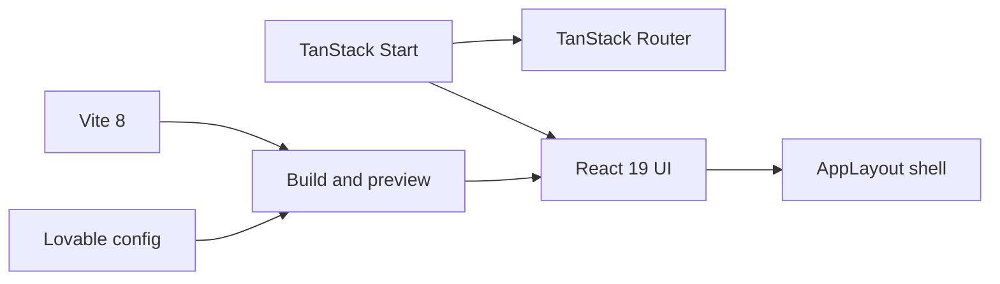
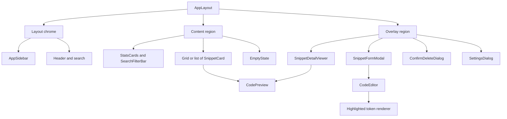
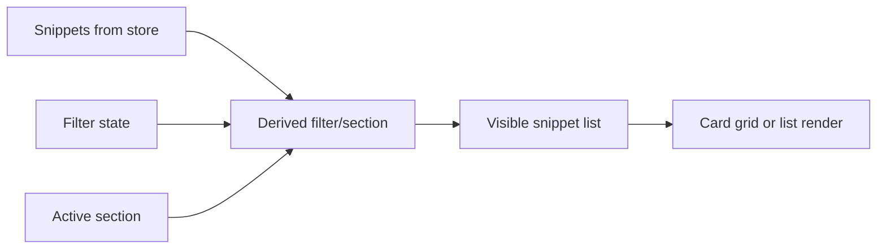
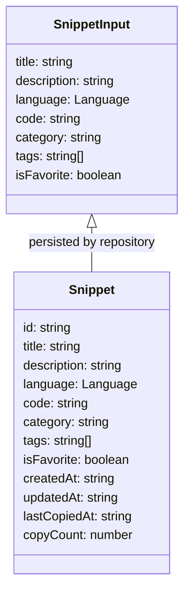
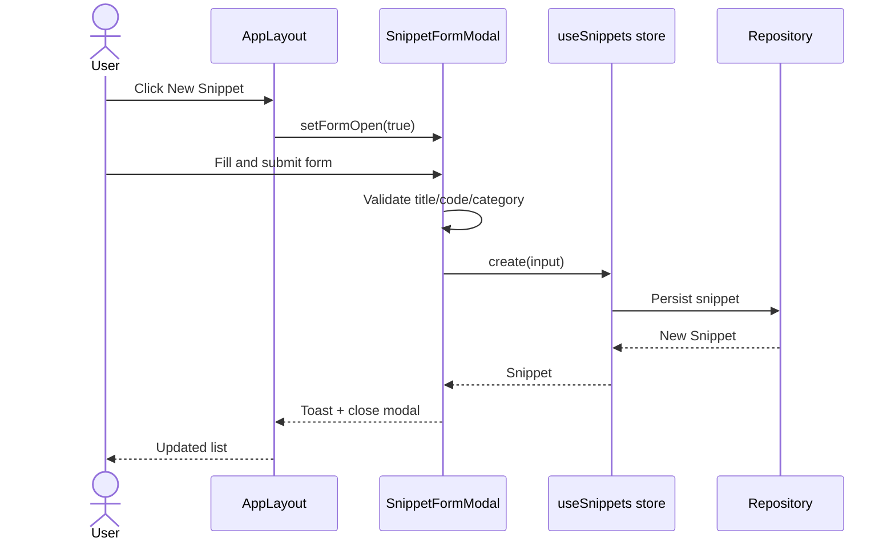

# CodeKnit architecture and design overview

CodeKnit is a client-side snippet manager built with TanStack Start, React 19, TypeScript, and Tailwind CSS. Snippets are stored in the browser's`localStorage` and accessed through a repository abstraction. The main application shell is`AppLayout.tsx`, which coordinates navigation, filtering, modals, and persistence through the`useSnippets()` store hook.

## Technology stack

The project uses Vite as its build tool and Lovable's TanStack Start configuration for local development and preview.

```json
{
  "scripts": {
    "dev": "vite dev",
    "build": "vite build",
    "build:dev": "vite build --mode development",
    "preview": "vite preview",
    "test": "vitest run"
  }
}
```

The key runtime and build dependencies from`package.json` are:

- **Framework:**`@tanstack/react-start` 1.168.60 with`@tanstack/react-router` 1.170.41 and`@tanstack/router-plugin`
- **UI layer:** React 19.2, Radix UI primitives, Tailwind CSS 4,`lucide-react`,`sonner` toasts
- **State data:**`@tanstack/react-query` 5.101.1 is available, though the snippet store uses a local hook
- **Build tooling:** Vite 8.1.5,`@lovable.dev/vite-tanstack-config` 2.26.5, Nitro 3.0 for server build support
- **Testing:** Vitest 4.1.10 with Testing Library and jsdom

Figure: Runtime and build stack for CodeKnit



## Main component hierarchy

`AppLayout.tsx` is the orchestrating component. It renders the sidebar, content area, and all overlay dialogs, and centralizes the state that these components receive through props.




### Top-level components

-`AppLayout.tsx`: owns the store connection and every top-level UI state value
-`AppSidebar.tsx`: navigation sections, category and language filters, counts, and workspace footer
-`SearchFilterBar.tsx`: search input, language/category/tag/sort selects, clear filters, and grid/list toggle
-`StatsCards.tsx`: dashboard summary of total snippets, favorites, and unique languages
-`SnippetCard.tsx`: card or list row for a snippet with copy, favorite, duplicate, edit, view, and delete actions
-`EmptyState.tsx`: empty library state with context-aware messaging
-`SnippetDetailViewer.tsx`: dialog that shows full snippet code and metadata
-`SnippetFormModal.tsx`: create and edit form with validation, custom categories, tag entry, and code editor
-`ConfirmDeleteDialog.tsx`: destructive confirmation dialog before permanent removal
-`SettingsDialog.tsx`: export JSON, import JSON, and reset the local library

### Shared rendering components

-`CodePreview.tsx`: read-only rendered code with optional line-number truncation
-`CodeEditor.tsx`: overlay editor where a transparent`textarea` sits above highlighted tokens for syntax coloring
-`LanguageBadge.tsx`: language badge with color dot and date formatting helper
-`Highlighted`: token renderer used by both`CodeEditor` and`CodePreview`

## State management patterns

The application uses a combination of a custom data store hook and local React state. All snippet data flows through`useSnippets()` from`@/lib/snippets/store`. All presentation and interaction state is owned by`AppLayout`.

### Store-backed data state

In`AppLayout.tsx`, the top of the component connects to the snippet store:

```tsx
const { snippets, status, error, reload, create, remove, toggleFavorite, recordCopied } = useSnippets();
```

The returned`snippets` array is the source of truth. The store also exposes asynchronous operations:

-`create(input)`, creates a snippet
-`remove(id)`, permanently deletes a snippet
-`toggleFavorite(id)`, flips the`isFavorite` flag
-`recordCopied(id)`, updates the copy count and most recent copy timestamp
-`reload()`, re-reads the underlying repository, typically after an error

The`status` value is one of`loading`,`ready`, or`error`, and`AppLayout` uses that to render skeletons, the normal content, or an error/retry panel.

### Local UI state in AppLayout

`AppLayout` manages eight separate local state values:

```tsx
const [section, setSection] = useState<Section>("dashboard");
const [filters, setFilters] = useState<SnippetFilters>(DEFAULTS);
const [layout, setLayout] = useState<"grid" | "list">("grid");
const [formOpen, setFormOpen] = useState(false);
const [editing, setEditing] = useState<Snippet | null>(null);
const [viewingId, setViewingId] = useState<string | null>(null);
const [deleting, setDeleting] = useState<Snippet | null>(null);
const [settingsOpen, setSettingsOpen] = useState(false);
```

These values control which section is active, which filters are applied, which snippet is being viewed or edited, and which dialogs are open. By keeping this state in`AppLayout`, the dialogs and cards stay controlled and do not need to coordinate with each other.

### Derived state

The displayed snippet list is derived, not stored separately. In`AppLayout.tsx`:

```tsx
const visible = useMemo(() => {
  const f = {
    ...filters,
    favoritesOnly: section === "favorites",
    sort: section === "recent" ? ("recent" as const) : filters.sort,
  };
  const r = filterSnippets(snippets, f);
  if (section === "recent") return r.slice(0, 10);
  if (section === "used") {
    return r
      .filter((s) => Boolean(s.lastCopiedAt))
      .sort((a, b) => (b.lastCopiedAt ?? "").localeCompare(a.lastCopiedAt ?? ""));
  }
  return r;
}, [snippets, filters, section]);
```

This is the main data pipeline: raw snippets from the store are passed through`filterSnippets` with the user's filters and active section, then sliced or re-sorted as needed.



The sidebar categories and language options are also derived from the`snippets` array with`useMemo`:

```tsx
const categories = useMemo(() => {
  const m = new Map<string, number>();
  snippets.forEach((s) => m.set(s.category, (m.get(s.category) ?? 0) + 1));
  return [...m].map(([name, count]) => ({ name, count })).sort((a, b) => a.name.localeCompare(b.name));
}, [snippets]);

const tags = useMemo(() => [...new Set(snippets.flatMap((s) => s.tags))].sort(), [snippets]);
```

### Persisted preferences

Layout preference is stored in`localStorage` under the key`codeknit.layout`.`AppLayout` reads it once on mount and writes it whenever the user toggles grid or list view:

```tsx
useEffect(() => {
  const saved = localStorage.getItem("codeknit.layout");
  if (saved === "list" || saved === "grid") setLayout(saved);
}, []);

const changeLayout = (l: "grid" | "list") => {
  setLayout(l);
  localStorage.setItem("codeknit.layout", l);
};
```

Snippet data persistence is handled by the repository layer behind`useSnippets()`, not by components directly. For details on the data schema and persistence implications, see [Understanding CodeKnit Snippet Storage and Data Persistence](../user-facing-docs/understanding-codeknit-snippet-storage-and-data-pe.md).

## Snippet data model

The UI code uses a`Snippet` object with the following observable fields. The type is defined in`@/lib/snippets/types`, and its usage is visible across`AppLayout.tsx`,`SnippetCard.tsx`,`SnippetDetailViewer.tsx`, and`SnippetFormModal.tsx`.




The`Language` type is a union derived from`LANGUAGES`. Based on`LanguageBadge.tsx` and the form's language select, the supported languages are:

- JavaScript
- Python
- SQL
- Markdown

`SnippetFormModal.tsx` builds its initial form data as a`SnippetInput`:

```tsx
const empty = (): SnippetInput => ({
  title: "",
  description: "",
  language: "JavaScript",
  code: "",
  category: "Utilities",
  tags: [],
  isFavorite: false,
});
```

When editing,`SnippetFormModal` strips the persisted-only fields from the existing snippet:

```tsx
if (editing) {
  const { id, createdAt, updatedAt, ...rest } = editing;
  setForm(rest);
}
```

## Core operation data flow

### Create and edit

1. User clicks **New Snippet** or **Edit** in`AppLayout`.
2.`AppLayout` sets`formOpen` to`true` and optionally sets`editing`.
3.`SnippetFormModal` initializes form state from either`empty()` or the snippet being edited.
4. The form validates`title`,`code`, and`category` before submitting.
5. On save, the form calls`create` or`update` from`useSnippets()`.
6. On success, the modal shows a toast and calls`onOpenChange(false)`.



### Delete

1. User chooses **Delete** from a card action or detail viewer.
2.`AppLayout` stores the pending snippet in`deleting`.
3.`ConfirmDeleteDialog` opens and shows the snippet title.
4. On confirm,`AppLayout` calls`remove(deleting.id)`.
5. If the deleted snippet was being viewed,`AppLayout` clears`viewingId`.
6. The dialog closes and the store state causes the list to refresh.

### Import and export

`SettingsDialog.tsx` handles backup and restore:

- **Export:** serializes the current`snippets` array to JSON, creates a Blob, and triggers a download named`codeknit-snippets.json`.
- **Import:** reads the selected JSON file, validates it with`parseSnippetImport`, then merges valid snippets through`importSnippets`. Existing snippets are kept and duplicates are skipped.
- **Reset:** calls`reset()` from the snippet store to restore sample data.

For a detailed workflow, see [How to Export and Import Snippets](../user-facing-docs/how-to-export-and-import-snippets.md).

## Key design decisions

### Single source of truth for snippet data

All components read from the`snippets` array returned by`useSnippets()`. There are no per-component copies of the snippet list. Categories, tags, visible snippets, and sidebar counts are computed with`useMemo` rather than duplicated state.

### Repository abstraction behind the store

Components call`create`,`update`,`remove`,`toggleFavorite`, and`recordCopied` on the store hook. They do not interact with`localStorage` directly. This makes it possible to swap the localStorage repository for an API or database backend without changing the UI. For the repository interface and CRUD semantics, see [Snippet Repository API and