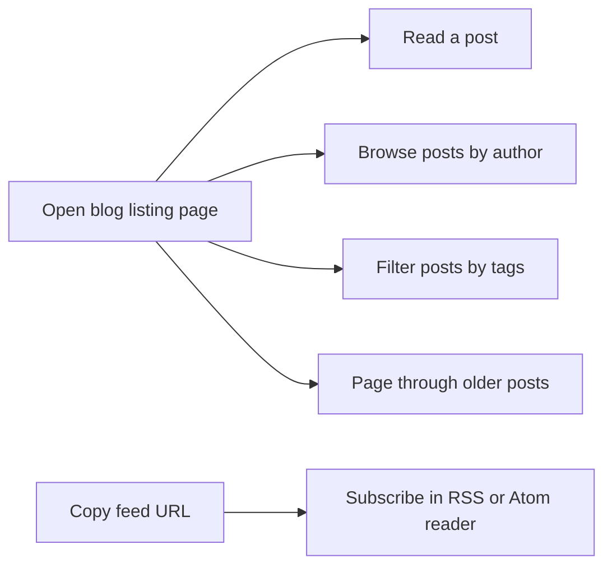
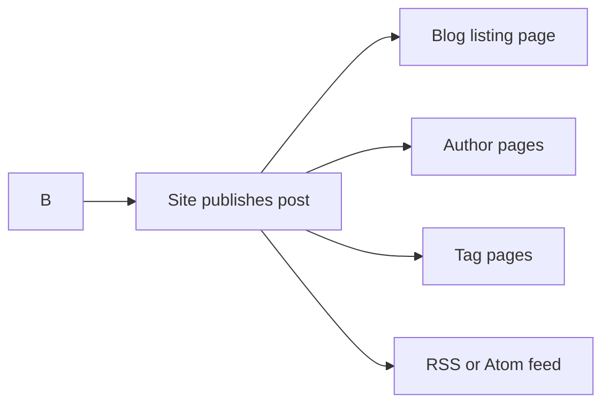

# Blog

Blog gives your site a dedicated place to publish, organize, and read longer posts. If you're a reader, you can discover posts, follow a particular author or topic, and subscribe for updates. If you're a content author, you can write a post and publish it so readers can find it across the site.

Posts are grouped by author and tag. The blog listing includes pagination so it stays easy to scan as more posts are published, and the site publishes an RSS or Atom feed so readers can follow you from their preferred reader app.

## What you can do as a reader

You can start at the blog listing page and choose any of these paths:

- Read a post in full
- Browse posts by a particular author
- Filter posts by tags to see only the topics that interest you
- Move through older posts using pagination
- Subscribe to the blog with the RSS or Atom feed

Figure: Blog reader journey

## What you can do as a content author

As a content author, you write posts in blog content files. Each post can carry an author and tags. Those details control where the post appears after it is published: on the listing page, on the author's pages, on matching tag pages, and in the site feed.

Figure: From a new post to reader discovery

## Key options

- **Authors** group posts by who wrote them
- **Tags** group posts by topic and let readers filter the listing
- **Pagination** breaks a long listing into smaller pages
- **RSS and Atom feeds** let readers subscribe to new posts

Some details, such as how many posts appear on each listing page, depend on your site's blog settings. For step-by-step instructions and available choices, use the dedicated How-to guides below.

> [!NOTE]
> This page explains the Blog feature overall. For exact steps and on-screen labels, open the relevant guide from the list.

## Related guides

- [Read blog posts](doc:8dec29d4-914f-42c1-ad4a-58b3923066cd)
- [Browse posts by author](doc:ca2bf8b1-3fe9-41c7-9f39-c0d952b34922)
- [Filter posts by tags](doc:da9e186e-2e74-4c49-9554-769d57a8aa79)
- [Paginate through the blog listing](doc:cad40b05-f8e4-461f-8d6d-f8d68130ab6d)
- [Publish a new blog post](doc:b53f4980-aa74-45a1-b075-f0b746ed9923)
- [Subscribe to the RSS or Atom feed](doc:33a9a7d1-25c6-4d6c-a982-408eb7ab60c1)
