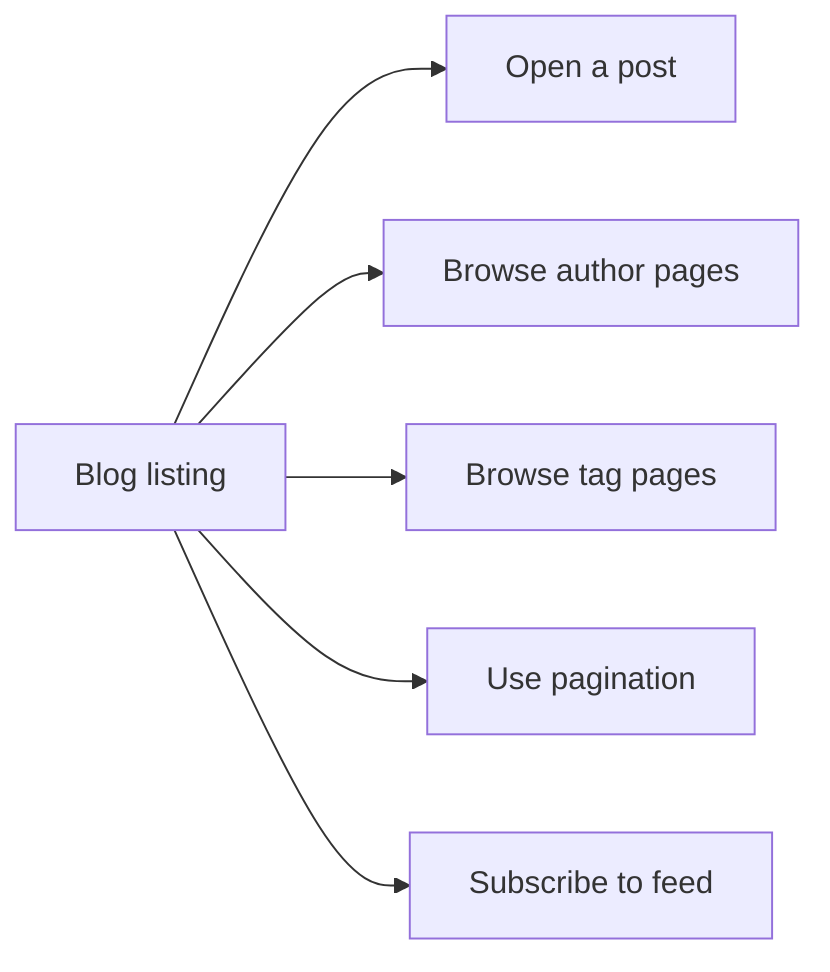
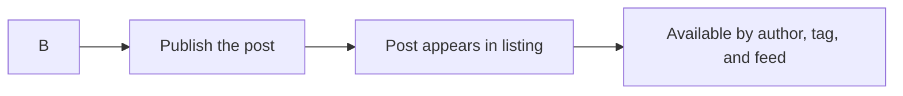

# Blog

The Blog feature gives your site a built-in home for articles, updates, and long-form content. It works for two audiences: readers who want to discover and read posts, and content authors who write and publish those posts.

Who it's for:

- **Blog readers** browse recent posts, read articles, find posts by author, filter by topic, and follow new content through a feed.
- **Content authors** publish new posts and organize them so readers can find them by author and tag.

## What you can do with blog

### Read posts

Readers start on the blog listing page, where they can see the available posts and open any post to read it in full.

- Read full posts from the listing
- Move between posts and other parts of the site
- Return to the listing to choose another article

If you're new to reading blog posts, see [How to read blog posts](doc:8dec29d4-914f-42c1-ad4a-58b3923066cd).

The diagram shows the main reader journey.

Figure: Blog reader journey

### Browse posts by author

Each post can be associated with an author. Readers can visit an author page to see all posts written by that person. This is useful when a site has several contributors and readers want to follow one writer.

See [How to browse posts by author](doc:ca2bf8b1-3fe9-41c7-9f39-c0d952b34922).

### Filter posts by tags

Tags group posts by topic. Readers can select a tag to see every post that shares that topic, which makes it easier to find related articles without searching the entire listing.

See [How to filter posts by tags](doc:da9e186e-2e74-4c49-9554-769d57a8aa79).

### Move through long listings with pagination

When a blog has many posts, the listing can be split into pages. Readers can move forward and backward through the listing to see older posts.

See [How to paginate through blog listing](doc:cad40b05-f8e4-461f-8d6d-f8d68130ab6d).

### Follow new posts with RSS or atom

Readers can subscribe to the blog's feed and receive updates when new posts are published. This removes the need to check the site manually for new content.

See [How to subscribe to RSS/Atom feed](doc:33a9a7d1-25c6-4d6c-a982-408eb7ab60c1).

### Publish and organize posts

Content authors can create new posts with the information readers rely on, including author and tags. Once published, the post becomes available on the blog listing, on the author's page, on related tag pages, and in the feed.

See [How to publish a new blog post](doc:b53f4980-aa74-45a1-b075-f0b746ed9923).

The diagram shows how a new post flows from content creation into the reader experience.

Figure: Publishing flow for content authors

## Benefits

- Gives readers a clear entry point to your site's articles and updates
- Helps readers find related content through authors and tags
- Keeps long listings manageable with pagination
- Lets readers follow new posts automatically with RSS or Atom
- Gives content authors a consistent way to publish and organize posts

## Key options and limits

- Posts can be organized by author and by tag
- Listings can be paginated for readability
- Readers can subscribe to RSS or Atom feeds
- The exact labels and positions of blog controls can vary depending on how the site is styled or configured

> [!NOTE]
> If a link or option described here is not visible, your site may not have the Blog feature enabled or may use different labels.

## Related

- [How to read blog posts](doc:8dec29d4-914f-42c1-ad4a-58b3923066cd)
- [How to browse posts by author](doc:ca2bf8b1-3fe9-41c7-9f39-c0d952b34922)
- [How to filter posts by tags](doc:da9e186e-2e74-4c49-9554-769d57a8aa79)
- [How to paginate through blog listing](doc:cad40b05-f8e4-461f-8d6d-f8d68130ab6d)
- [How to publish a new blog post](doc:b53f4980-aa74-45a1-b075-f0b746ed9923)
- [How to subscribe to RSS/Atom feed](doc:33a9a7d1-25c6-4d6c-a982-408eb7ab60c1)
