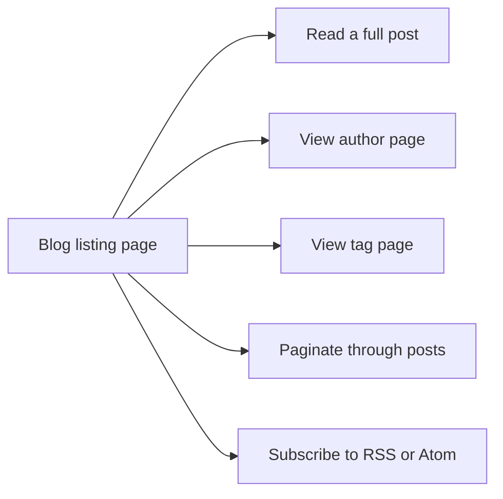
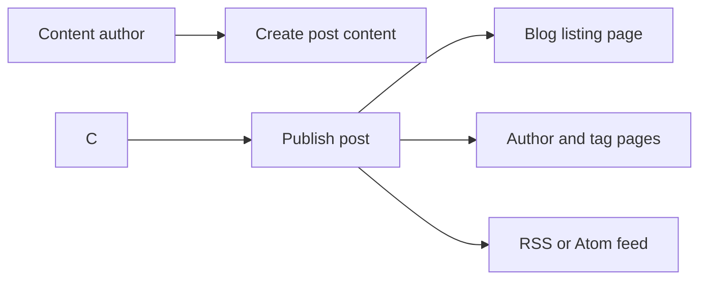

# Blog

The Blog feature gives your site a dedicated space for publishing and reading dated articles, updates, and news. It serves two audiences: readers who want to find, read, and follow content, and content authors who publish and manage posts.

## What you can do

### Read and browse posts
The blog opens on a listing page that displays published posts. You can open any post to read the full article, use pagination to move through older entries, browse posts by author, or view all posts that share a tag.

### Follow the blog with feeds
The blog provides an RSS or Atom feed. You can subscribe to the feed URL in your preferred feed reader to receive new posts automatically.

### Publish posts
As a content author, you can publish a new post by providing the post's content and details such as author, tags, and publication date. Once published, the post appears on the blog listing, its author page, its tag page, and in the feed.

The diagram below shows the main ways readers move through the blog from the listing page.

Figure: Blog reading and browsing flow

The next diagram shows how a published post reaches each part of the blog.

Figure: Publishing a new blog post

## Benefits
- Readers quickly find posts by topic or author.
- Subscribers stay current through RSS or Atom without revisiting the site.
- Authors publish once, and the post reaches all blog surfaces.

## Key options and limits
- Posts support authors and tags for organization.
- The blog listing supports pagination.
- Feeds are available in RSS and Atom formats.
- The available documentation doesn't specify the number of posts shown per listing page or include draft and scheduling controls.

## Related
- [How to read blog posts](doc:8dec29d4-914f-42c1-ad4a-58b3923066cd)
- [How to publish a new blog post](doc:b53f4980-aa74-45a1-b075-f0b746ed9923)
- [How to browse posts by author](doc:ca2bf8b1-3fe9-41c7-9f39-c0d952b34922)
- [How to filter posts by tags](doc:da9e186e-2e74-4c49-9554-769d57a8aa79)
- [How to paginate through blog listing](doc:cad40b05-f8e4-461f-8d6d-f8d68130ab6d)
- [How to subscribe to RSS or Atom feed](doc:33a9a7d1-25c6-4d6c-a982-408eb7ab60c1)
