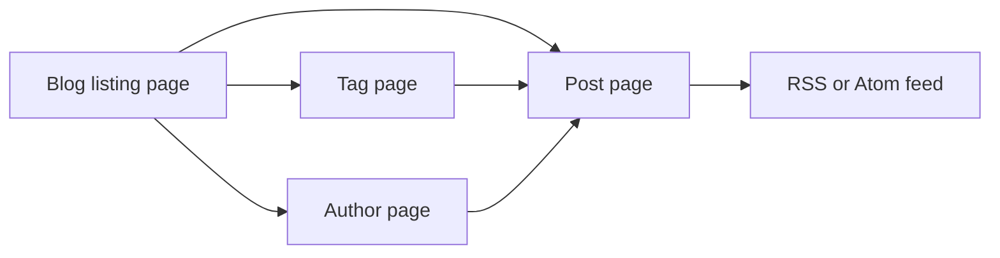
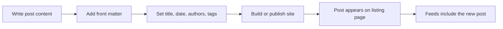
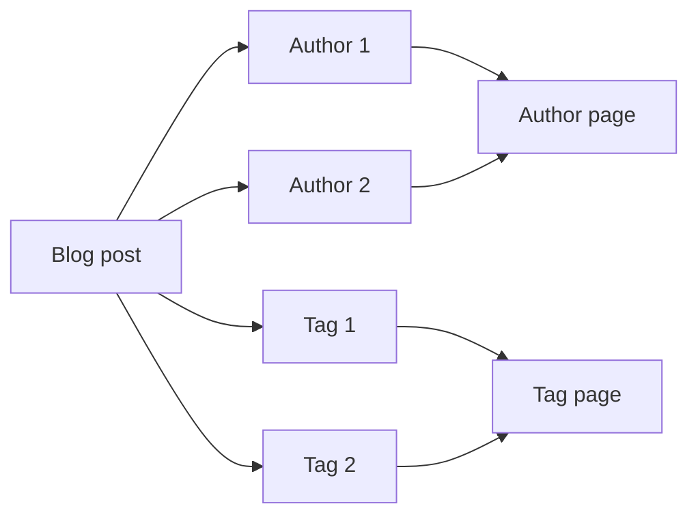

# Blog

The blog is a publishing space where content authors share articles and readers explore posts by date, topic, or writer. It's designed for two audiences: **content authors** who write and publish posts, and **blog readers** who browse, read, and subscribe.

## What you can do

The blog supports five core capabilities:

- **Publish posts.** Content authors write posts as Markdown files and add front matter with details such as title, date,`authors`, and`tags`. The site builds these files into published blog posts.
- **Read posts.** Readers start at the **blog listing page**, which shows published posts. Each entry links to a full **post page** where the complete article is displayed.
- **Filter by tags.** Each post can carry one or more tags. Selecting a tag opens a **tag page** that lists every post with that tag, so readers can explore a topic without searching.
- **Browse by author.** Each post can name one or more authors. Selecting an author opens an **author page** that lists every post by that person.
- **Subscribe via feeds.** The blog publishes RSS and Atom feeds. Readers can subscribe by pointing a feed reader at the **feed URL**.

## How the blog fits together

The blog listing page is the starting point for readers. From there, you can open any post, narrow to a tag, or view an author's posts. The feed offers a subscription path that doesn't require visiting the site.

Figure: Blog navigation flow

## Publishing workflow

Publishing is file-based. You write a post, add front matter with the post's`title`, date,`authors`, and`tags`, and then build or publish the site. The post then appears on the listing page, on each matching tag page, on each author page, and in the feeds.

Figure: Publishing a new blog post

## Authors and tags

Authors and tags are how the blog organizes posts beyond the listing page:

- **Authors** are named in a post's front matter. Each author has an **author page** that collects all their posts.
- **Tags** are topic labels, also set in front matter. Each tag has a **tag page** that collects all posts carrying that tag.
- A single post can have multiple authors and multiple tags.

Figure: How a post relates to authors and tags

Because of these relationships, one post can be reached from several places: the main listing, each of its tag pages, and each of its author pages.

## Pagination

When the blog has more posts than fit comfortably on one page, the **blog listing page** splits them into pages. Page controls let you move between listing pages, keeping older posts reachable without excessive scrolling.

## Benefits

- **Readers** get an easy way to browse posts by date, topic, or writer, and to subscribe for updates without returning to the site.
- **Content authors** get a simple publishing flow: write a post, add front matter, and the blog automatically places it on the listing, author, and tag pages.
- **Visitors** can follow specific authors or topics without creating an account.

## Key options and limits

The blog's primary options are:

- **Author pages**, generated for each author named in post front matter
- **Tag pages**, generated for each tag used in post front matter
- **Pagination** on the blog listing page
- **RSS and Atom feeds** available at the blog's feed URL

The source files provided for this task document the CodeKnit snippet manager rather than the blog plugin implementation. Details such as the exact number of posts shown per listing page, the full set of supported front matter fields, and the precise feed URL are therefore not covered here.

## Related

- [How to publish a new blog post](doc:b53f4980-aa74-45a1-b075-f0b746ed9923)
- [How to read blog posts](doc:8dec29d4-914f-42c1-ad4a-58b3923066cd)
- [How to browse posts by author](doc:ca2bf8b1-3fe9-41c7-9f39-c0d952b34922)
- [How to filter posts by tags](doc:da9e186e-2e74-4c49-9554-769d57a8aa79)
- [How to paginate through the blog listing](doc:cad40b05-f8e4-461f-8d6d-f8d68130ab6d)
- [How to subscribe to the RSS or Atom feed](doc:33a9a7d1-25c6-4d6c-a982-408eb7ab60c1)
