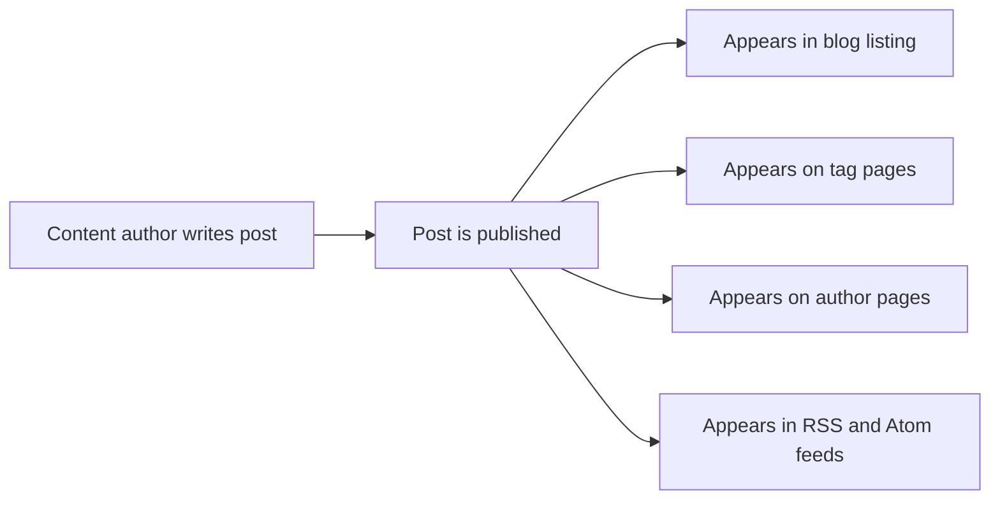
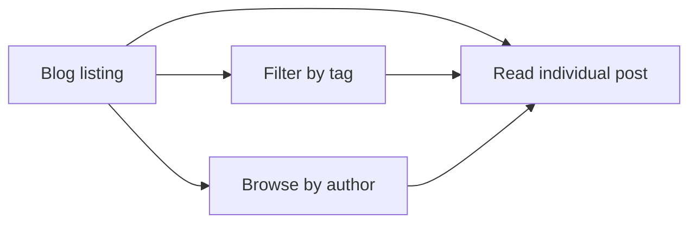

# Blog

The Blog is your site's publishing space where content authors share articles and updates, and readers can discover and read that content. Posts appear chronologically in a listing page, can be explored by author or topic, and are available through feed subscriptions so readers can stay up to date.

## Who it's for

- **Blog readers** can read posts, move through the listing page by page, filter by tags, browse posts by a specific author, and subscribe to RSS or Atom feeds.
- **Content authors** can write and publish posts to share with readers.

## What you can do

### Read posts

Open any post from the blog listing to read the full article. Each post displays its title, author, publication date, and associated tags. See [How to read blog posts](doc:8dec29d4-914f-42c1-ad4a-58b3923066cd).

### Navigate the post listing

The blog listing presents published posts in reverse chronological order (newest first). When there are more posts than fit on one page, you can move forward and backward through the listing. See [How to paginate through blog listing](doc:cad40b05-f8e4-461f-8d6d-f8d68130ab6d).

### Filter posts by tags

Every post can carry one or more tags that describe its topic. Selecting a tag shows all posts that share that tag, making it easy to find related content. See [How to filter posts by tags](doc:da9e186e-2e74-4c49-9554-769d57a8aa79).

### Browse posts by author

Posts are attributed to one or more authors. You can view a dedicated page for an author that lists all of their published posts. See [How to browse posts by author](doc:ca2bf8b1-3fe9-41c7-9f39-c0d952b34922).

### Subscribe to updates

The Blog publishes RSS and Atom feeds, so you can receive new post notifications in the feed reader of your choice. See [How to subscribe to RSS/Atom feed](doc:33a9a7d1-25c6-4d6c-a982-408eb7ab60c1).

### Publish new posts

Content authors can add new posts and publish them. Once published, a post appears in the listing, on its tag and author pages, and in the RSS and Atom feeds. See [How to publish a new blog post](doc:b53f4980-aa74-45a1-b075-f0b746ed9923).

## How content flows after publishing

When a post is published, it becomes visible in every relevant view at the same time. This diagram shows where a published post appears.

Figure: Where a published post appears

## How readers navigate the blog

You can reach an individual post through several paths: directly from the listing, from a tag page, or from an author page.

Figure: Ways to find and read a post

## Benefits

- **Multiple discovery paths**: Tags and authors give you more than one way to find relevant content.
- **Current, then older**: The listing shows the newest posts first, with pagination to reach older material.
- **Subscription-friendly**: RSS and Atom feeds deliver new posts without requiring you to revisit the site.
- **Clear roles**: Authors focus on writing; readers focus on reading. No technical setup is required for either role.

## Limits

- Only published posts appear in the blog listing, tag pages, author pages, and feeds.
- The listing displays a fixed number of posts per page; you cannot change the page size when browsing.
- Posts carry only the metadata that was provided at publish time (author, tags, and date); readers cannot modify them.
