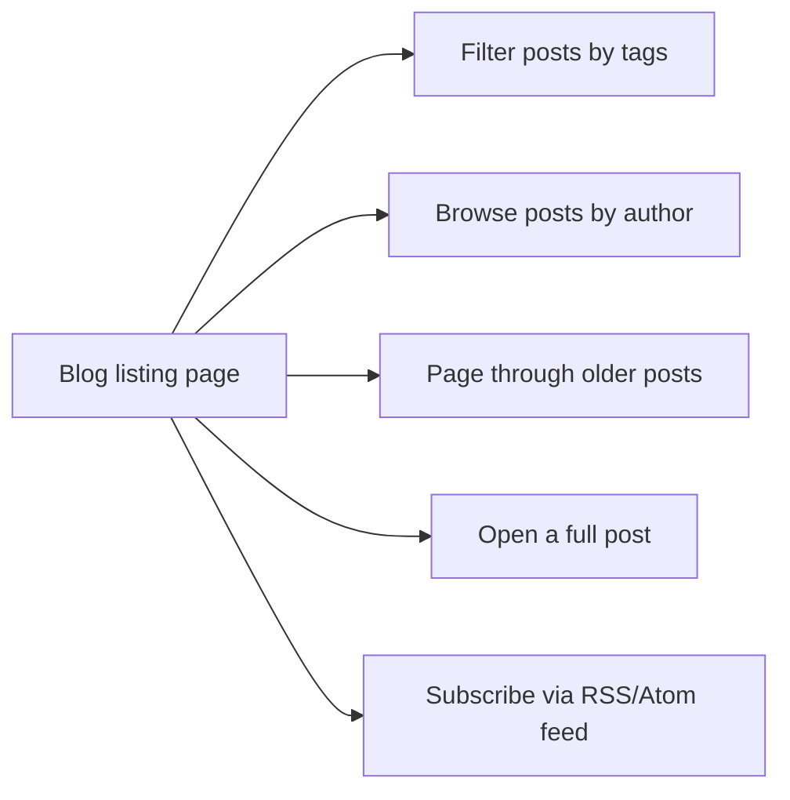
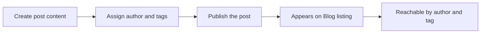

# Blog

Blog is the publishing area of your site where readers discover updates and where content authors share new posts. It turns a collection of authored content into a browsable, taggable, paginated experience with subscription feeds.

## Who it's for

Blog serves two audiences:

- **Blog readers** who want to find, filter, read, and subscribe to posts.
- **Content authors** who create and publish posts with authors and tags.

## What you can do

### Read posts

Open the Blog listing page to see available posts. Select any post to read it in full. The listing is the starting point for most reader journeys.

### Browse posts by author

Each post is associated with an author. Select an author to open their Author page and see all posts they have written. This is useful when you want to follow a specific voice or contributor.

### Filter posts by tags

Posts carry tags that describe their topics. Select a tag to open its Tag page and see every post sharing that tag. Tags let you move quickly from one post to related material.

### Page through the listing

The Blog listing page is divided into pages. Use pagination controls to move through older and newer posts without scrolling an endless feed.

### Subscribe to updates

Blog exposes an RSS/Atom feed. Point your feed reader at the Feed URL to receive new posts automatically as they are published.

### Publish posts

Content authors create posts with a title, body, author, and tags. Once published, a post appears on the Blog listing page and is reachable through its author and tag pages.

## How blog fits together

The Blog listing page is the central hub. From there, readers can branch into author pages, tag pages, individual posts, pagination, or a subscription feed.

Figure: Blog reader journey

The publishing flow is separate. It begins with a content author creating a post and ends with that post becoming discoverable across the reader-facing areas of Blog.

Figure: Publishing a blog post

## Benefits

- **Organized discovery:** readers can browse by author or topic instead of scrolling one long list.
- **Focused reading:** pagination keeps the listing manageable and quick to move through.
- **Staying current:** the RSS/Atom feed delivers new posts to readers who prefer subscriptions.
- **Clear authorship:** author pages group content around contributors, making it easy to follow people.

## Key options and limits

- Authors group posts on dedicated Author pages.
- Tags group related posts on dedicated Tag pages.
- The Blog listing is paginated; readers move through it page by page.
- RSS/Atom subscription is available through a Feed URL.
- Publishing is available to content authors, while browsing, filtering, pagination, and feeds serve readers.

## Related pages

- [How to read blog posts](doc:8dec29d4-914f-42c1-ad4a-58b3923066cd)
- [How to browse posts by author](doc:ca2bf8b1-3fe9-41c7-9f39-c0d952b34922)
- [How to filter posts by tags](doc:da9e186e-2e74-4c49-9554-769d57a8aa79)
- [How to paginate through blog listing](doc:cad40b05-f8e4-461f-8d6d-f8d68130ab6d)
- [How to publish a new blog post](doc:b53f4980-aa74-45a1-b075-f0b746ed9923)
- [How to subscribe to RSS/Atom feed](doc:33a9a7d1-25c6-4d6c-a982-408eb7ab60c1)
