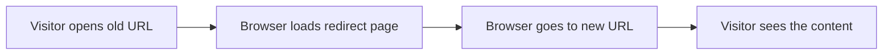
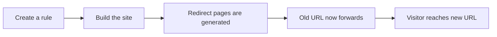

# Client-Side redirects

Client-side redirects keep your site's links working when pages move, change names, or disappear. They are for site administrators, maintainers, and content authors who manage a documentation website and want to preserve search engine rankings and user bookmarks when URLs change.

## What you can do

Client-side redirects help you in four main ways:

- Forward visitors from an old URL to the new location of a page
- Handle page renames without visitors seeing a "page not found" error
- Redirect broken or legacy URLs to their current equivalents
- Configure rules for localized, multi-language paths so visitors land on the correct language version

When you build the site, the system creates a small page for each old URL. When a visitor opens one of those pages, the browser immediately sends them to the correct new address.

Figure: What happens when a visitor opens an old URL

## Who it is for

| Role | What they use it for |
| --- | --- |
| Site administrator | Keeping old links and bookmarks working across the whole site |
| Content author | Renaming pages without breaking existing links |
| Developer | Generating redirect pages as part of the build |

## Benefits

- Visitors with saved bookmarks still reach the content they expect
- Search engines transfer ranking value from the old URL to the new one
- No need to manage redirect rules on the web server itself
- Redirects are checked and created automatically when the site is built

## Key options

- Define rules that map an old path to a new path
- Apply rules to localized paths so each language version redirects correctly
- Generate redirect pages as part of the normal site build
- Handle page renames that happen when content files are reorganized

## Limits

- Redirects run in the visitor's browser, not on the server. The browser briefly opens a redirect page before moving to the new address.
- Redirect pages are created only when the site is built and published. You must rebuild and republish to activate new rules or changes.
- Rules apply to paths you explicitly define. A redirect is not created automatically for every moved page unless a rule is added for it.

## Setting up redirects

Figure: The redirect setup flow

The process is straightforward:

1. A site administrator or content author decides which old URL should point where.
2. The rule is written in the redirect settings.
3. The site is built, which generates a redirect page for each rule.
4. Visitors who open an old URL are automatically taken to the new one.

## Related guides

- [How to redirect broken or legacy URLs](doc:f184b303-4e11-463c-a652-a1805c4e4d60)
- [How to handle page renames without 404s](doc:3bba0cd8-b2ff-4a98-b4b7-c1569009a038)
- [How to configure redirect rules for localized paths](doc:83261685-f759-485c-ab93-e876b7a69a5f)
- [How to generate redirect pages at build time](doc:667e20e0-0f37-49dd-b9ea-c8cf180727d6)
- [Documentation](doc:7e97fe70-a638-4596-bb48-adfef8fb0b61)
- [Site Building & Bundling](doc:0fcd8337-ee59-484f-bda3-4db080caa340)
