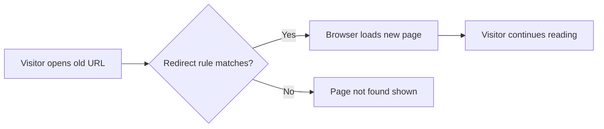

# Client-Side redirects

Client-Side Redirects keep links working when you move, rename, or reorganize pages on your site. When a visitor opens an old URL, they are instantly taken to the correct new location, without seeing a "page not found" error. This preserves search ranking and keeps saved bookmarks valid for returning readers.

## Who it's for

Client-Side Redirects are for site administrators and maintainers who:

- Rename pages or restructure content sections
- Migrate from an older URL scheme
- Need to retire or replace a broken or legacy URL
- Care about preserving SEO equity and user bookmarks

Visitors experience the benefit automatically: they open a link, and it works, no error page, no manual search.

## How redirects work

A redirect maps one web address to another. When a browser requests a page at the old address, the site detects the match and immediately loads the destination page instead.

Figure: Redirect flow for a moved page

## Key options

The link catalog for this documentation set identifies four practical redirect scenarios, each covered in its own guide:

| Scenario | Typical audience |
|----------|-----------------|
| Handle a page rename without creating a broken link | Content author |
| Redirect broken or legacy URLs | Site administrator |
| Generate redirect pages during the build | Developer |
| Configure redirect rules for localized paths | Site administrator |

You can link to these guides inline as needed:

- To handle page renames without 404s, see [How to handle page renames without 404s](doc:3bba0cd8-b2ff-4a98-b4b7-c1569009a038).
- To redirect broken or legacy URLs, see [How to redirect broken or legacy URLs](doc:f184b303-4e11-463c-a652-a1805c4e4d60).
- To generate redirect pages at build time, see [How to generate redirect pages at build time](doc:667e20e0-0f37-49dd-b9ea-c8cf180727d6).
- To configure redirect rules for localized paths, see [How to configure redirect rules for localized paths](doc:83261685-f759-485c-ab93-e876b7a69a5f).

## Benefits

- **No broken bookmarks**: readers who saved an old link still reach the intended content.
- **SEO continuity**: search engines follow the redirect and transfer ranking signals to the new address.
- **Safer content changes**: you can rename pages and restructure sections with confidence that existing links continue to work.
- **Reduced maintenance**: define redirects once rather than hunting down and updating every reference to a moved page.

## Scope and limits

This overview describes the client-side redirect capability and its outcomes. The provided source files for this repository do not include redirect configuration code or route definitions, so the specific mechanism for defining redirect rules is not verified in the provided source. The following boundaries apply:

- Redirects apply to moved or renamed URLs and to broken or legacy links.
- Redirect generation can occur as part of the build process.
- Localized paths may require separate redirect rules.
- The provided source confirms the project runs as a client-side React application with TanStack Start and TanStack Router (`package.json`), which is consistent with client-side redirect handling, but no redirect tables, plugin options, or route definitions appear in the prefetched files.

> [!NOTE]
> Configuration details vary by platform. Always refer to the specific guide linked above for the exact steps that apply to your scenario, and test a redirected URL after making changes.

## Next steps

- Learn to manage renaming safely: [How to handle page renames without 404s](doc:3bba0cd8-b2ff-4a98-b4b7-c1569009a038)
- Configure redirects for legacy links: [How to redirect broken or legacy URLs](doc:f184b303-4e11-463c-a652-a1805c4e4d60)
- Explore the broader site-generation workflow: [Site Building & Bundling](doc:0fcd8337-ee59-484f-bda3-4db080caa340)
