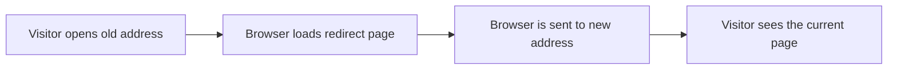

# Client-Side redirects

Client-side redirects keep your site's links working when pages move, get renamed, or are removed. When a visitor opens an old address, a lightweight redirect page opens in their browser and immediately sends them to the current location. This protects search rankings and keeps saved bookmarks valid.

## Who it's for

Client-side redirects are for site administrators and maintainers who manage the structure and addresses of a documentation site. Content authors who rename pages also benefit, because the feature keeps their readers from landing on "not found" pages.

## What you can do

You can create rules that map an old address to a new address. During a site build, the system generates a redirect page for each rule. Visitors who follow a stale link or saved bookmark are carried to the current page without taking any extra action.

The feature covers several common situations:

- **Moved or renamed pages**, when you rename a page, you set the old name to redirect to the new one so readers find the right place.
- **Broken or legacy addresses**, when you reorganize or retire pages, redirects guide visitors from old addresses to the best current equivalent.
- **Localized addresses**, when you publish content in multiple languages, you can set up redirects that respect each language version of a path.

## Benefits

- **Preserves search rankings**, search engines follow the redirect and associate the old address with the replacement page, retaining ranking value.
- **Protects user bookmarks**, visitors who saved an old address reach the correct page with no manual effort.
- **Reduces error pages**, renamed or removed pages no longer strand visitors at a "not found" state.
- **No server configuration required**, redirects run in the visitor's browser at the moment the page loads.

Figure: How a visitor follows a moved page

## Key options

You configure redirects through the site's build settings. Two approaches are available:

- **Explicit redirect rules**, you list an old address alongside a new address, and the build turns each pair into a redirect page.
- **Rename handling**, when a page is renamed, the site's redirect capability can create an automatic link from the old address to the new one.

The behavior can also be customized for localized sites. For example, a redirect for the English address can point to the English replacement, while the French address points to its French equivalent.

## How redirects behave

Each redirect is a small, static page created during the build. When it opens, it sends the browser onward to the destination address. The result is a smooth transition from the old link to the current page.

## Limits

- **Requires a site build**, redirect pages are generated at build time, so adding or changing a redirect means rebuilding the site before visitors can use it.
- **Specific destinations only**, every redirect points to an address you provide. It does not guess where a moved page went.
- **Browser-side handling**, the redirect happens in the visitor's browser, not on the web server. The behavior is part of the built page rather than a server response.

## Related

- [How to configure redirect rules for localized paths](doc:83261685-f759-485c-ab93-e876b7a69a5f)
- [How to generate redirect pages at build time](doc:667e20e0-0f37-49dd-b9ea-c8cf180727d6)
- [How to handle page renames without 404s](doc:3bba0cd8-b2ff-4a98-b4b7-c1569009a038)
- [How to redirect broken or legacy URLs](doc:f184b303-4e11-463c-a652-a1805c4e4d60)
