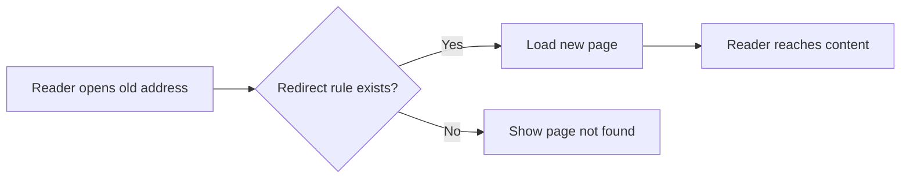

# Client-Side redirects

Client-side redirects keep your documentation site's links working when pages move, change names, or share a new address. When a reader opens an old address, the site automatically takes them to the correct page instead of showing a page-not-found error.

## What client-side redirects do

Moving a page typically breaks every link that points to it. That includes links from other websites, search engine results, browser bookmarks, and your own in-site navigation. Client-side redirects fix this by loading a small page at the old address that quickly forwards readers to the new address.

The redirect happens in the reader's browser. That means old addresses continue to work even when the original page no longer exists at its previous location.

## Who this feature is for

Client-side redirects are for **site administrators** and **site maintainers** who:

- Rename or reorganize documentation pages
- Migrate content from an older site structure
- Localize documentation paths for multiple languages
- Retire or merge pages without losing incoming visitors

## What you can do

### Keep renamed pages working

When you rename a page, you can set up a redirect so its old address keeps working. Readers who visit the old address are taken to the new page. This removes the worry of broken links when you improve page titles or restructure sections.

### Redirect broken or legacy addresses

Older addresses from before a migration or a major restructuring can point to their current equivalents. This keeps incoming links from search engines and other sites leading to the right content.

### Generate redirect pages automatically

The site produces redirect pages as part of the normal build process. You define redirect rules once, and the site generates a redirect page for each one. There's no need to create pages by hand.

### Support localized paths

Redirect rules work with localized content paths. You can define a redirect once and have it apply across every language your site supports.

Figure: How a redirect gets readers to the right page

## Benefits

- **Preserved search ranking**: search engines follow redirects and update their indexes, so you keep the search value of the old address.
- **Continuity for bookmarks**: readers who saved old addresses keep reaching the content they need.
- **Fewer broken links**: redirects reduce the chance of errors, especially after a large content reorganization.
- **Smoother migrations**: moving from an older platform or address structure is safer when old addresses still work.

## Key options

### Redirect rule configuration

You define redirect rules that map old addresses to new addresses. Each rule specifies the old path and the destination path. Rules can cover a single page or a pattern of pages that share a common address structure.

### Build-time generation

Redirect pages are produced during the site build. The production site then serves them as static pages, with no need for server-side configuration or ongoing runtime logic.

### Cross-language support

Redirect rules can apply across localized paths, so the same logical redirect works in every language your site supports.

## Limits to keep in mind

- Redirects run in the reader's browser, so the old address must first load a small forwarding page before the new page appears. This is normally quick and invisible to readers.
- Each redirect must be defined before the site builds. Redirects added after a build don't exist until the site is rebuilt.
- Redirect rules match old addresses exactly unless you define them as a pattern. Keep your rules focused on actual moves and legacy links.
- Defining a large number of redirects produces many small forwarder pages. Keep the rule set focused to avoid unnecessary build output.

> [!NOTE]
> Client-side redirects complement, but do not replace, good site organization. Use them to bridge old addresses after you change a site, not as a long-term replacement for keeping addresses stable.

## Related topics

- [How to handle page renames without 404s](doc:3bba0cd8-b2ff-4a98-b4b7-c1569009a038)
- [How to redirect broken or legacy URLs](doc:f184b303-4e11-463c-a652-a1805c4e4d60)
- [How to configure redirect rules for localized paths](doc:83261685-f759-485c-ab93-e876b7a69a5f)
- [How to generate redirect pages at build time](doc:667e20e0-0f37-49dd-b9ea-c8cf180727d6)
