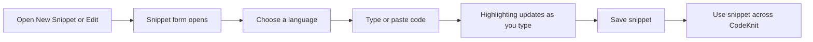
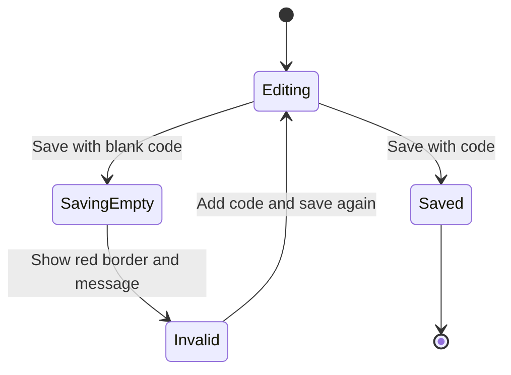

# Code editor

CodeKnit includes a built-in code editor for writing and updating snippets of code and Markdown in your browser. You use it when you create a new snippet or edit an existing one. The editor works like a lightweight writing surface for code: it highlights syntax using CodeKnit’s built-in language support, keeps line numbers aligned, and helps you indent quickly as you work.

The code editor is part of the snippet form. When you open **New Snippet** or choose **Edit** on an existing snippet, the code editor appears under the other snippet details. You can type, paste code, change the selected language, and save your work from the same screen.

## What the code editor includes

| Capability | What it does |
| --- | --- |
| Syntax highlighting | Colors code and Markdown based on the selected language |
| Line numbers | Shows a number for each code line on the left |
| Tab indentation | Pressing **Tab** inserts two spaces at the cursor |
| Horizontal scrolling | Long lines stay on one line and scroll sideways |
| Required code check | Shows a red border and error message if you save with no code |
| Paste support | Accepts code and text pasted from your clipboard |

### Supported languages

The editor highlights these four languages:

-`JavaScript`
-`Python`
-`SQL`
-`Markdown`

When you choose a language from the **Language** menu in the snippet form, the editor updates the colors and emphasis to match that language. For example, comments, strings, keywords, functions, numbers, and variables each get a distinct color. In Markdown, headings and bold text appear emphasized, and links appear underlined. CodeKnit keeps the highlighting up to date as you type.

To learn more about how CodeKnit colorizes your content, see [Syntax Highlighting](doc:0cc5fd84-0d94-4faf-ab51-00f580e726a4).

Figure: Code editing flow in CodeKnit

## Writing and editing code

The editor area shows a language-aware code surface. When the code area is empty, you see the hint **“// Paste or write your code here.”** You can type normally or paste code from another tool. The highlighted preview behind your text updates automatically as the code changes.

Line numbers appear on the left side of the editor. The editor always shows at least 8 numbered lines, even when your snippet is shorter. As you add more lines, the line numbers grow with your content.

Long lines do not wrap. If a line is too wide for the editor, a horizontal scroll bar lets you move through the full line. If your snippet grows taller than the editor area, a vertical scroll bar appears so you can continue working without stretching the page.

### Keyboard shortcuts

The code editor keeps your hands on the keyboard for common actions.

| Key or action | Result |
| --- | --- |
| **Tab** in the code area | Inserts two spaces at the cursor and moves the cursor forward |
| **Shift+Tab** in the code area | Not supported as an un-indent shortcut; use **Backspace** to remove spaces |
| **Enter** or comma in the tag field | Adds the current tag |
| **Backspace** in the tag field | Removes the last tag |
| Standard typing or paste | Updates the code and the syntax highlighting |

The tag field sits next to the code editor in the same snippet form. Use **Enter** or a comma to finish a tag, and use **Backspace** to delete the last tag you added.

## Required code validation

The code field is required when you save a snippet. CodeKnit does not silently accept an empty code area. If you try to save without entering any code, the editor displays a red border and the message **“Code is required.”** Add code and save again to clear the validation state.

> [!NOTE]
> The code editor checks that the code area is not empty. It does not flag syntax errors or correct your code.

Figure: Required code check

## Where the editor appears

The editable code editor is available in two places:

- **New snippet form**: Select **New Snippet**, enter your snippet details, and type or paste code into the code area.
- **Edit snippet form**: Open a snippet, choose **Edit**, and update the existing code or Markdown content.

When you view a saved snippet without editing it, CodeKnit shows a read-only highlighted preview instead of the editable editor. To make changes, open the snippet and choose **Edit**.

Snippets saved from the code editor become part of your reusable library. To learn more about how saved snippets are stored and organized, see [Snippet Library](doc:9f431e10-b005-4cc0-80b1-0af4acdcb3d8).

## Benefits

CodeKnit’s code editor is designed to feel lightweight and responsive. It works directly in the browser and does not require a separate program or heavy editor add-on. The editor supports multiple common coding and writing languages, so you can store a wide range of snippets without learning a new tool.

## Boundaries

The code editor is focused on writing and editing individual snippets. It is not a full development environment.

- No collaborative or multi-user editing
- No debugging tools, breakpoints, or error reporting
- No code completion, refactoring, or project-wide search
- No automatic detection of syntax errors
- No automatic line wrapping for long lines
- **Shift+Tab** does not remove indentation

## Related

- [Syntax Highlighting](doc:0cc5fd84-0d94-4faf-ab51-00f580e726a4)
- [Snippet Library](doc:9f431e10-b005-4cc0-80b1-0af4acdcb3d8)
- [Your First Snippet – Quick Start](doc:72dab710-31b9-4980-becf-be9fbd6d4d94)
- [Product Overview](doc:ca8f433d-53d1-475b-a3a5-29b24f1ba173)
