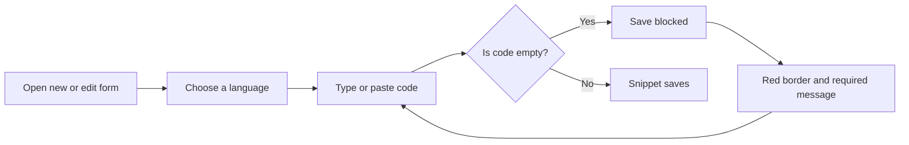

# Code editor

The Code Editor is the built-in space where you write and edit the code or Markdown stored in your snippets. You type directly in the browser, see colors that make the structure easier to scan, and save your work without opening a separate tool. It's for anyone who creates or updates snippets in CodeKnit.

## Where you'll find it

When you select **+ New Snippet** or choose **Edit** from a snippet's **More actions** menu, the Code Editor appears inside the form. The same colorful display also appears in read-only form on snippet cards and in the detail viewer, so what you see while typing matches what you see later when viewing.

## Supported languages

The editor recognizes four languages:

- JavaScript
- Python
- SQL
- Markdown

Highlighting updates automatically when you change the **Language** selection in the form. You can switch at any time before saving.

## Writing code in the editor

The editor works like a simple text field that understands code. When you open a new snippet, it shows the hint`// Paste or write your code here`. Spell-checking is turned off so your code is not flagged as misspelled.

Figure: Writing and saving in the Code Editor

## Keyboard shortcuts

Inside the code area,`Tab` inserts two spaces at the cursor and the cursor moves ahead by two spaces. This makes indenting code quick without adding spaces one at a time. Pressing`Tab` repeatedly adds two more spaces each time.

| Key | What it does |
| --- | --- |
|`Tab` | Inserts two spaces for indentation |

Pressing`Shift+Tab` does not remove indentation in this version.

## Syntax highlighting

As you type, the editor colors different parts of the text so you can read it faster. Comments, strings, keywords, numbers, and function names each get distinct treatment. In Markdown, headings, bold text, and links also stand out. The colors follow the language you selected; switch from JavaScript to SQL and the highlighting rules update immediately.

To learn more about how the colorization works, see [Syntax Highlighting](doc:0cc5fd84-0d94-4faf-ab51-00f580e726a4).

## Line numbers and scrolling

The editor shows a line number for every line you are working in. It always displays at least eight numbered rows, even before you have written anything. Long lines do not wrap; instead, the editor scrolls horizontally so the exact formatting of your code is preserved.

## Validation

Code is required. If you try to save a snippet with empty code, the editor shows a red border and a message below the field: **Code is required.** Add code and save again to continue.

## Tags field shortcuts

While you are in the form, the **Tags** field has its own quick keys:

- Press`Enter` or`,` (comma) to add a tag you have typed
- Press`Backspace` in an empty tag to delete the previous tag

## What it doesn't do

The Code Editor is intentionally lightweight. It does not offer:

- Collaborative editing, your library is stored in this browser
- Debugging, no breakpoints, watch windows, or error traces
- IDE-like features, no autocomplete, refactoring tools, or code quality checks
- An outdent shortcut —`Shift+Tab` does not remove indentation

## Related

- [Snippet Library](doc:9f431e10-b005-4cc0-80b1-0af4acdcb3d8)
- [Syntax Highlighting](doc:0cc5fd84-0d94-4faf-ab51-00f580e726a4)
- [Your First Snippet – Quick Start](doc:72dab710-31b9-4980-becf-be9fbd6d4d94)
