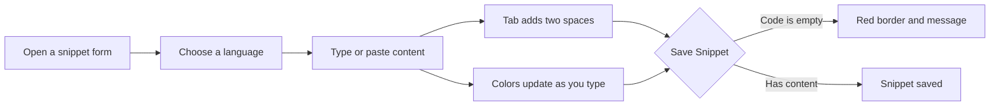

# Code editor

The Code Editor is where you write and update the code or Markdown content for your snippets in CodeKnit. It's for anyone who creates, edits, or revises a snippet. The editor is built into the snippet form, so you can type or paste content, see it highlighted in the selected language, and save it without leaving your browser.

Learn more about what CodeKnit is in [Product Overview](doc:ca8f433d-53d1-475b-a3a5-29b24f1ba173).

## What the editor offers

The Code Editor gives you a focused writing space for snippet content. When you open the **New Snippet** or **Edit** form, the editor appears under the **Code** label.

The editor is lightweight and responsive. It adjusts to the available width in the snippet form and shows your content in a monospaced, code-friendly layout.

## Where you'll use it

You use the Code Editor when you create or edit a snippet. When you create a snippet, choose **New Snippet** from the sidebar or header. When you edit a snippet, open the snippet and choose **Edit**.

In other places in CodeKnit, your code appears in a read-only preview that shows syntax colors and line numbers but does not allow editing. This read-only view appears on snippet cards and in the snippet detail view.

## Supported languages

The editor highlights content for four languages:

- JavaScript
- Python
- SQL
- Markdown

Use the **Language** dropdown in the snippet form to choose a language. The highlighting updates automatically to match the language you select. For example, keywords, strings, comments, numbers, headings, and links can appear in different colors depending on the language.

For more detail on how colors are applied, see [Syntax Highlighting](doc:0cc5fd84-0d94-4faf-ab51-00f580e726a4).

## Editing your content

To edit content:

1. Open a new or existing snippet in the snippet form.
2. Select a language from the **Language** dropdown.
3. Select the **Code** field and type or paste your content.

The editor shows an empty-state hint when no content is present: **// Paste or write your code here**.

Line numbers appear on the left side of the editor. The editor always shows at least 8 line-numbered rows, even when your content is shorter. Longer content scrolls vertically within the editor. Long lines stay on a single row, and you can scroll horizontally to see the rest of a line.

As you type, syntax colors update in the editing area. You can change the language at any time, and the highlighting changes to match.

## Keyboard shortcuts

The editor supports these keyboard actions:

- Press`Tab` to insert two spaces at the cursor. This helps you indent code or Markdown.
- Press`Backspace` normally to remove characters, including indentation spaces.

In the **Tags** field, which appears in the same snippet form, you can:

- Press`Enter` or`Comma` to add a tag.
- Press`Backspace` to remove the last tag.

For more on tags and categories, see [Snippet Organization](doc:8367ddb8-1051-4848-a093-3b4352805aa4).

Figure: Code editing and save flow

## Saving and validation

When you save a snippet, CodeKnit checks that the **Code** field is not empty. If you leave the code area blank and choose **Save Snippet**, the editor displays a red border and a message below the field. If the field has content, the snippet saves normally.

> [!NOTE]
> The editor checks that the code field is not empty. It does not check whether your code is syntactically correct, and it does not run or execute your code.

## What the editor does not do

The Code Editor is intentionally simple. It is not a full development environment. It does not support:

- Collaborative editing by multiple people at once
- Debugging tools or code execution
- Breakpoints, variable inspection, or a terminal
- Advanced IDE-style features such as code completion, refactoring, or version history

## Next steps

- To create and save your first snippet, see [Your First Snippet – Quick Start](doc:72dab710-31b9-4980-becf-be9fbd6d4d94)
- To learn how content is colored, see [Syntax Highlighting](doc:0cc5fd84-0d94-4faf-ab51-00f580e726a4)
- To organize snippets with categories and tags, see [Snippet Organization](doc:8367ddb8-1051-4848-a093-3b4352805aa4)
