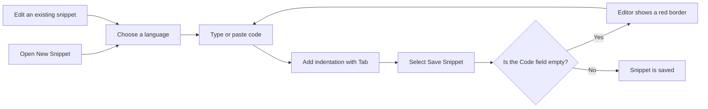

# Code editor

The Code Editor in CodeKnit is where you write and edit the code or Markdown saved in each snippet. It runs right in your browser and supports JavaScript, Python, SQL, and Markdown, so you can write notes, queries, and scripts without leaving CodeKnit.

## What you can do

- Write or paste code and Markdown in the **Code** field of the snippet form.
- Choose a language from the **Language** dropdown to get immediate, color-coded guidance as you type.
- Use the`Tab` key to add indentation.
- See line numbers along the left edge and scroll through longer content.
- Rely on required-field feedback that catches an empty **Code** field before you save.

## Where editing happens

The editor appears when you create or update a snippet:

1. Select **New Snippet** to open a blank snippet form with a fresh editor.
2. Open an existing snippet and select **Edit**. The same editor opens with that snippet's code ready to update.

When you view a snippet's details, CodeKnit shows the code in a read-only highlighted preview. To type in the editor, select **Edit** from the detail view.

Figure: Snippet editing flow

## Choose a language and see immediate highlighting

The editor supports four languages:

- JavaScript
- Python
- SQL
- Markdown

Select the language in the **Language** dropdown. The editor then recolors your content automatically, helping you distinguish comments, strings, keywords, function names, numbers, and Markdown structure. The colors are visual only and do not change the code you have saved.

For more on how highlighting works, see [Syntax Highlighting](doc:0cc5fd84-0d94-4faf-ab51-00f580e726a4).

## Keyboard shortcuts

| Keys | Action |
| --- | --- |
|`Tab` | Insert two spaces at the cursor, or replace selected text with two spaces |
|`Enter` or`,` in the **Tags** field | Add the tag you just typed |
|`Backspace` in an empty **Tags** field | Remove the last tag |

> [!NOTE]
> Pressing`Tab` replaces any selected text with two spaces. If you want to keep the selected text, first place the cursor where you need the indentation.

The **Tags** field sits in the same snippet form as the editor, so you can stay on the keyboard when organizing a snippet. For more on organizing snippets, see [Snippet Organization](doc:8367ddb8-1051-4848-a093-3b4352805aa4).

## Line numbers and scrolling

The editor displays line numbers on the left side. A new or empty editor shows enough numbered rows to fill the visible area, and the numbering grows with your content. When your code exceeds the visible height, you can scroll vertically. Long lines do not wrap; you can scroll horizontally to read them.

## Validation and error feedback

The **Code** field is required. If you try to save a snippet with no code, the editor gets a red border and a **Code is required.** message appears beneath it. Add or paste some code, then select **Save Snippet** again.

## What the editor does not do

The Code Editor is intentionally lightweight. It does not run code, support shared or simultaneous editing, provide debugging tools, or include full IDE features such as code completion and refactoring. It is designed for capturing, editing, and reusing snippets quickly.
