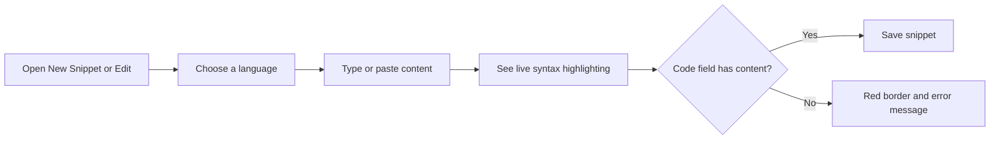

# Code editor

Write, edit, and format code or Markdown for your snippets directly in your browser. The Code Editor gives you live, color-coded syntax and simple keyboard helpers so you can create readable, reusable snippets without leaving CodeKnit.

## What the Code editor is

The Code Editor is the built-in editing area for snippets. It appears when you create a new snippet or edit an existing one. As you type or paste content, the editor automatically colors keywords, strings, numbers, comments, and, in Markdown, headings, bold text, and links. The highlighting updates to match the language you've chosen for the snippet.

The editor is lightweight and runs quickly without loading a heavy editing add-on. It's designed for focused editing, not for full-scale development work.

## Who it's for

The Code Editor is for anyone who creates or updates snippets in CodeKnit, including developers, data analysts, technical writers, and anyone who saves reusable code or Markdown.

With the editor, you can:

- Format code with consistent indentation
- See visual confirmation of the language you're using
- Catch missing content before saving
- Keep your original line breaks and spacing exactly as you wrote them

## Supported languages

You can choose one of these languages for each snippet:

- JavaScript
- Python
- SQL
- Markdown

When you change the language in the snippet form, the editor automatically re-highlights the content. For example, SQL keywords are colored like other code keywords, while Markdown shows styled headings, bold text, and links.

For more on how highlighting works, see [Syntax Highlighting](doc:0cc5fd84-0d94-4faf-ab51-00f580e726a4).

## Writing and editing content

The editor uses a monospace font and displays line numbers on the left, starting at 1. Long lines keep their exact spacing and scroll horizontally instead of wrapping, so your code doesn't get reformatted.

### Indent with the tab key

1. Click in the code field where you want to indent.
2. Press **Tab**.
3. The editor inserts two spaces at the cursor.

If you have text selected when you press **Tab**, the editor replaces the selection with two spaces.

## How editing and saving fit together

When you create or edit a snippet, you choose a language, type or paste your content, and then save. If the required code field is empty when you try to save, the editor shows a red border and an error message.

Figure: Code Editor editing and saving flow

## Keyboard shortcuts

| Shortcut | Where | Result |
| --- | --- | --- |
| **Tab** | Code field | Inserts two spaces at the cursor, or replaces selected text with two spaces |
| **Enter** | Tag field | Adds the current tag |
| **,** (comma) | Tag field | Adds the current tag |
| **Backspace** | Tag field | Removes the previous tag |

> [!NOTE]
> The tag field is separate from the code field. It appears in the same snippet form and helps you organize the snippet with tags while you edit the code.

## Validation and error feedback

When you try to save a snippet without content in the code field, the editor marks the field with a red border and the form shows the message **Code is required**. The red border disappears once you add content.

## Where the editor appears

The editable Code Editor appears in the **New Snippet** and **Edit snippet** dialogs.

When you view a saved snippet in the detail view or on a snippet card, you see a read-only, color-highlighted preview of the code. To change the code from the detail view, select **Edit** to open the editable Code Editor.

## What the Code editor doesn't do

The Code Editor is focused on writing and formatting snippet content. It doesn't include:

- Collaborative or real-time editing with others
- Debugging tools or the ability to run code
- Code completion or inline suggestions
- Multi-file browsing, split panes, or other IDE-style features

## Related

- [Syntax Highlighting](doc:0cc5fd84-0d94-4faf-ab51-00f580e726a4)
- [Snippet Library](doc:9f431e10-b005-4cc0-80b1-0af4acdcb3d8)
- [Snippet Organization](doc:8367ddb8-1051-4848-a093-3b4352805aa4)
- [Your First Snippet – Quick Start](doc:72dab710-31b9-4980-becf-be9fbd6d4d94)
