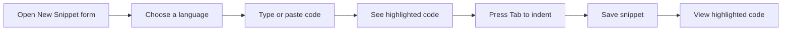
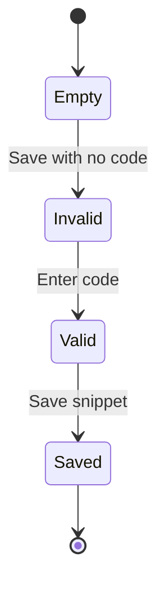

# Code editor

The Code Editor lets you write and edit snippet content directly in your browser. When you create or edit a snippet, the editor colorizes your code the same way CodeKnit displays it everywhere else, so what you type always matches what you will see later.

## What you can do

The editor supports four languages:

- **JavaScript**
- **Python**
- **SQL**
- **Markdown**

As you type or paste content, the editor automatically colors comments, strings, keywords, functions, numbers, variables, and other elements based on the selected language. Markdown gets special treatment for headings, bold text, and links.

## Where the editor appears

The Code Editor is the **Code** field in both the **New Snippet** and **Edit Snippet** forms. When you open the form, the editor is ready for input. When you edit an existing snippet, it opens with the current code filled in and the highlighting already active.

In other places, you see a read-only version of the same highlighting:

- **Snippet detail window**, shows the full code with colors but no editing
- **Snippet cards**, show a short preview with the same colors

To change a snippet's code, open it and click **Edit**. The form opens with the editor active.

## The editing area

The editor includes:

- **Line numbers** on the left, starting at 1
- A **monospace font** with comfortable line spacing
- A **scrolling area** that grows with your content up to a maximum height, then scrolls

Long lines extend horizontally instead of wrapping. You can scroll sideways to read or edit the rest of a long line.

## Keyboard shortcuts

| Key | Action |
|-----|--------|
| **Tab** | Inserts 2 spaces at the cursor position |

Pressing **Shift+Tab** does not remove existing indentation.

> [!NOTE]
> The **Tags** field elsewhere in the same form has its own keyboard behavior, including pressing **Enter** or **,** (comma) to add a tag and **Backspace** to remove the last tag. Those shortcuts apply to the Tags field, not to the Code Editor.

## Validation

When you save a snippet, CodeKnit checks that the **Code** field is not empty. If it is empty, the editor shows a **red border**, and the message **Code is required.** appears below the field. Type or paste content and save again.

The editor does not check whether your code is syntactically correct for the selected language. It only highlights what you write and checks that the field is not blank.

Figure: Writing and saving a snippet with the Code Editor

Figure: Code field validation while saving

## Boundaries

The Code Editor is intentionally lightweight. It is not a full development environment and does not include:

- Collaborative or real-time editing with other people
- Debugging tools, breakpoints, or code execution
- Code completion, refactoring, or other IDE-style assistance
- Automatic detection of syntax errors beyond the empty-field check

## Related

- Learn how [Syntax Highlighting](doc:0cc5fd84-0d94-4faf-ab51-00f580e726a4) colorizes your code
- Create your [first snippet](doc:72dab710-31b9-4980-becf-be9fbd6d4d94) with the Code Editor
- Understand the [core concepts](doc:08c7b9ec-c366-4fc5-b62c-01999c0ae167) behind snippets and languages
- See how snippets are [organized](doc:8367ddb8-1051-4848-a093-3b4352805aa4) after you save them
