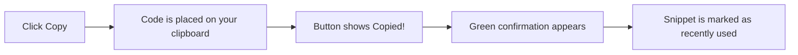
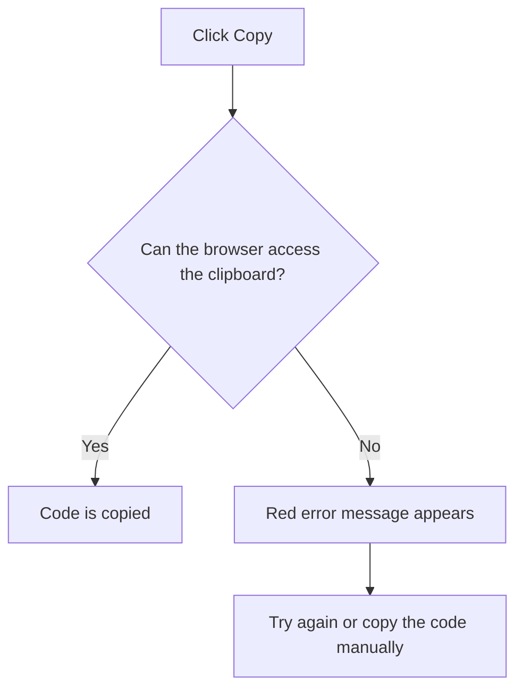

# Copy to clipboard

Copy to Clipboard lets you move a snippet's code onto your device's clipboard with one click. From there, you can paste it directly into a code editor, terminal, or chat message, no manual selecting, no keyboard shortcuts needed.

## Why use it

Copying code by hand means carefully selecting the right lines, worrying about missed characters, and switching between windows. Copy to Clipboard removes those steps. It's designed for anyone who stores reusable code in the [Snippet Library](doc:9f431e10-b005-4cc0-80b1-0af4acdcb3d8) and wants to reuse it quickly.

With Copy to Clipboard you can:

- Copy a full snippet without opening it, right from its card
- Copy from the full detail view when you need more context first
- Get instant visual confirmation that the copy worked
- See which snippets you have used recently

## Where to copy from

You can copy a snippet from two places in CodeKnit.

**From a snippet card.** Every snippet in your library shows a **Copy** button at the bottom of the card. This is the fastest option: you don't need to open the snippet first. The button sits next to **View**.

**From the detail view.** When you open a snippet, a **Copy code** button appears near the bottom of the detail view. Use this when you want to read the code or check the description before copying.

In both places, the button changes as soon as the code is copied: a check mark replaces the copy icon and the label becomes **Copied!**.

## What happens when you copy

Figure: Copy to Clipboard success flow

After a successful copy, CodeKnit also updates your usage information:

- The snippet's copy count increases. You can see this as **Copied 3 times** on the card or in the detail view.
- The snippet appears in **Recently Used** in the sidebar, ordered by your most recent copy. This makes it easy to find the snippet you just used.
- A green confirmation message appears on screen so you know the copy succeeded.

## When copying is blocked

Some browsers or websites restrict clipboard access. If your copy cannot complete, CodeKnit shows a red error message that explains the problem.

Figure: What happens when the browser blocks copying

Common reasons copying may not work:

- **The site is not using HTTPS.** Clipboard access generally requires a secure connection. If you're running CodeKnit on`localhost`, that counts as secure for most browsers.
- **The browser asks for permission or blocks the copy.** If you see a permission prompt, allow clipboard access and try again.
- **The snippet is very large.** Copying still works, but pasting very large code into another app may take longer.

If copying is blocked, you can still select the code in the preview and use your system's normal copy command (`Ctrl+C` on Windows,`Cmd+C` on Mac).

## Related

- [Snippet Library](doc:9f431e10-b005-4cc0-80b1-0af4acdcb3d8), understand where your snippets live
- [Favorites](doc:b66c5560-9b68-42eb-922d-a8aecab0dfcb), mark snippets for quick access
- [Product Overview](doc:ca8f433d-53d1-475b-a3a5-29b24f1ba173), see how CodeKnit fits together
