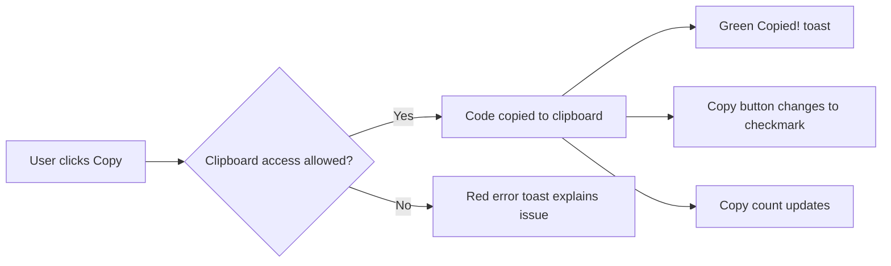

# Copy to clipboard

Copy any snippet’s code to your system clipboard with a single click. You can copy from a snippet card or from the snippet detail view, then paste directly into an editor, terminal, or chat without selecting the text by hand.

## What you can do

- Copy a snippet’s full code with one click
- Paste it into any app that accepts text
- See clear visual confirmation when a copy succeeds
- Understand and resolve clipboard access problems when they occur

## Where to find the copy buttons

**On a snippet card:** The **Copy** button appears in the lower-right corner of every snippet card in your library.

**In the snippet detail view:** When you open a snippet, a **Copy code** button appears in the action row along with **Edit**, **Delete**, and **Favorite**.

## What happens when you copy

When you click **Copy** or **Copy code**, CodeKnit attempts to place the snippet’s code on your clipboard using your browser’s secure clipboard features.

Figure: Copy to clipboard flow

On success, a green **Copied!** toast appears near the bottom of the screen. The copy button changes to a checkmark and reads **Copied!** briefly, then returns to its normal state.

If the browser blocks clipboard access, a red error toast appears and explains the issue. Nothing is copied in that case.

## Copy history and usage stats

Each snippet keeps track of how often and when you’ve copied it:

- The snippet card shows **Copied X time(s)** below the updated date, once at least one copy has been recorded.
- The snippet detail view shows the copy count, created date, updated date, and last copied date.
- The sidebar’s **Recently Used** section lists snippets that have a last copied date, ordered with the most recently copied first.

## Troubleshooting clipboard access

If copying doesn’t work as expected, check these common causes:

- CodeKnit must be running over a secure connection (HTTPS) or on`localhost`. Some browsers block clipboard writes on insecure pages.
- A few browsers ask for permission the first time you copy. Follow the browser prompt to allow access.
- Very large snippets may take a moment to appear when you paste. Wait briefly after copying.
- Read any red error toast that appears; it explains the specific reason clipboard access was blocked.

> [!NOTE]
> Your copy history and usage stats are stored only in your browser, alongside your snippet library.

## Related

- [Snippet Library](doc:9f431e10-b005-4cc0-80b1-0af4acdcb3d8)
- [Code Editor](doc:a1109ff6-5fe7-437a-99ec-4d0b442bb0fd)
- [Your First Snippet – Quick Start](doc:72dab710-31b9-4980-becf-be9fbd6d4d94)
- [Product Overview](doc:ca8f433d-53d1-475b-a3a5-29b24f1ba173)
