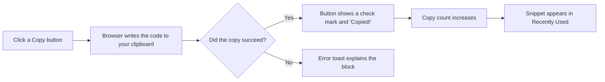

# Copy to clipboard

Copy to Clipboard lets you grab any snippet's code with a single click and paste it wherever you need it—your editor, terminal, a document, or a chat message. You can copy from either a snippet card in the library or from the full snippet details view. Each copy is recorded in the snippet's usage stats, so you can see how often you've reused a snippet and find your most recently copied snippets in one place.

## Who it's for

Anyone who keeps code or Markdown snippets in CodeKnit and routinely transfers them into another tool. Developers, writers, and power users benefit most: copying a snippet by hand means selecting long blocks of text, which is slow and error-prone. The Copy button removes that effort and works entirely without a keyboard.

## What you can do

- Copy the full code or Markdown body of any snippet with one click
- See immediate visual confirmation when the copy succeeds
- Track how many times each snippet has been copied
- Find recently copied snippets through the **Recently Used** view
- Receive a clear error message when your browser blocks clipboard access

## Where you can copy

Copy buttons appear in two places:

- **Snippet cards**, each card in the library has a **Copy** button in its footer
- **Snippet details**, when you open a snippet, a **Copy code** button appears near the bottom actions

The copy action always targets the snippet's full code body, not a partial selection.

## What happens after you copy

Figure: Copy action flow

When the copy succeeds, the button briefly shows a check mark and the label **Copied!** instead of **Copy** or **Copy code**. This visual change confirms the code is on your system clipboard and ready to paste.

After a successful copy:

- The snippet's **copy count** increases by one. You can see this count on the snippet card and in the details view, where it appears as **Copied N times**.
- The snippet is added to or moved to the top of the **Recently Used** list. This view lives in the sidebar under **Recently Used** and shows snippets ordered by their most recent copy time.
- The snippet's **last copied date** updates and appears in the details view under the snippet.

## What you see on the screen

- **On a snippet card**: the copy button uses a small copy icon next to the word **Copy**. After a successful copy, it briefly changes to a check mark and the word **Copied!**.
- **In the details view**: the button says **Copy code**. After a successful copy, it briefly shows a check mark and **Copied!**.
- The copy count and last copied date appear in both the card footer and the details footer, so you can review usage at a glance.

## If the copy fails

Clipboard access can fail for a few reasons. When that happens, CodeKnit shows a red error toast explaining the issue, and the code is not copied. Common causes include:

- **Browser security policy**, most browsers only allow clipboard writes on pages served over a secure connection (HTTPS) or from a special local address such as`localhost`
- **Browser permission prompts**, some browsers ask for permission before allowing clipboard access; declining it blocks the copy
- **Browser settings**, certain browsers or extensions restrict clipboard writes to protect your data

In these cases, you can still copy the code manually by selecting the code text and using your usual keyboard or context-menu copy command.

## Limits to keep in mind

- **Secure connection required**, clipboard access generally works only when CodeKnit is served over HTTPS or from`localhost`. Opening the page from an insecure`http` address may cause copies to fail.
- **Large snippets may feel slow**, very large snippets can take a moment to appear after pasting, depending on your system and the target app. The copy itself is immediate, but pasting thousands of lines into some editors can introduce a short delay.
- **Copy counts are local**, usage stats are stored per snippet in your browser and track copies made from CodeKnit's copy buttons, not manual copies or copies made in other tools.

## Related

- [Snippet Library](doc:9f431e10-b005-4cc0-80b1-0af4acdcb3d8)
- [Snippet Organization](doc:8367ddb8-1051-4848-a093-3b4352805aa4)
- [Favorites](doc:b66c5560-9b68-42eb-922d-a8aecab0dfcb)
- [Search and Filter](doc:3704cb56-cf68-421d-9db0-d3816a8af756)
