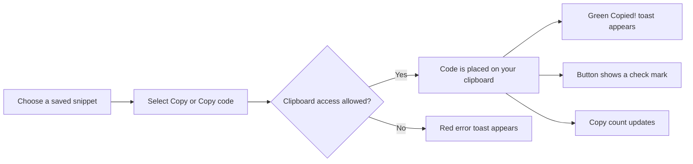

# Copy to clipboard

Copy to Clipboard lets you copy any saved snippet's full code to your device clipboard with one click. You can copy from a snippet card or from the snippet detail view, then paste the code into an editor, terminal, chat, or document.

## Who it's for

Copy to Clipboard is for anyone who saves and reuses code often. It removes the need to drag through lines of text or memorize keyboard shortcuts just to move a snippet.

## What you can do

- Copy a snippet directly from its card without opening the full view.
- Copy from the snippet detail view by using the **Copy code** action.
- Confirm a successful copy with a green **Copied!** toast and a temporary check mark on the button.
- See how many times each snippet has been copied and when it was last copied.
- Reopen frequently copied snippets from the **Recently Used** section in the navigation.

## How copying works

When you choose a copy action, CodeKnit places the snippet's code on your system clipboard. If the browser allows clipboard access, the app shows visual confirmation and records the copy. If the browser blocks access, the app shows an error message instead.

Figure: Copying a snippet

## Copying from a snippet card

Each snippet card includes a **Copy** button in its lower action area. Select **Copy** to place the complete snippet on your clipboard without opening the snippet. The card stays in place while the action runs.

## Copying from the snippet detail view

Open any snippet to see its full code. In the lower action area, select **Copy code** to copy the complete snippet. The detail view also shows the snippet's total copy count, created and updated dates, and last copied date when available.

## Visual feedback and copy tracking

A successful copy gives you two immediate cues: the green **Copied!** toast appears near the edge of the screen, and the copy button temporarily shows a check icon with the **Copied!** label.

After a successful copy, CodeKnit updates the snippet's usage details:

- The snippet card shows **Copied** followed by the number of times it has been copied, once that count is greater than zero.
- The snippet detail view shows the total copy count and the last copied date.
- The snippet appears in **Recently Used** under the navigation, ordered by the most recent copy.

> [!TIP]
> Use the **Recently Used** section to quickly reopen the snippets you copy most often.

## Troubleshooting clipboard access

A red error toast appears when the browser blocks access to your clipboard. This can happen for a few reasons.

- **Secure connection required:** Your browser generally allows clipboard writes only on secure pages, such as HTTPS or localhost. If CodeKnit is running on an unsecured address, copying may be blocked.
- **Permission prompts:** Some browsers ask for permission before allowing clipboard access. If permission is denied, you may need to allow clipboard access in your browser settings for the current site.
- **Very large snippets:** Large snippets are still copied, but pasting them into another application may take a moment longer than usual.

If the copy button does not change to **Copied!** and no error toast appears, verify that you are using a current browser and that the page is being served over HTTPS or localhost.

## Related

- [Snippet Library](doc:9f431e10-b005-4cc0-80b1-0af4acdcb3d8)
- [Search and Filter](doc:3704cb56-cf68-421d-9db0-d3816a8af756)
- [Favorites](doc:b66c5560-9b68-42eb-922d-a8aecab0dfcb)
- [Your First Snippet – Quick Start](doc:72dab710-31b9-4980-becf-be9fbd6d4d94)
