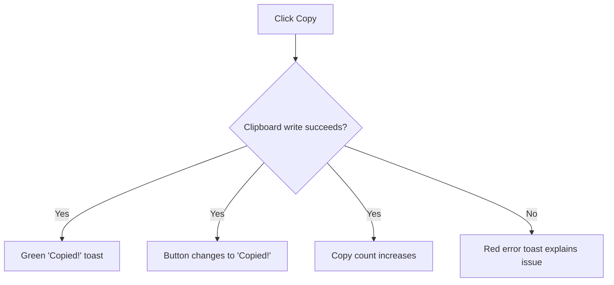

# Copy to clipboard

Copy any snippet to your clipboard with one click, then paste it straight into your editor, terminal, or another document. You don't need to select text, remember keyboard shortcuts, or retype anything.

## Who it helps

Copy to Clipboard is for anyone who saves code or Markdown snippets in CodeKnit and wants to reuse them quickly. Whether you're moving code into a project or reusing a saved text block, one click places the full snippet on your clipboard.

## Where you can copy

You can copy a snippet from two places:

- **Snippet cards** – each card in the library has a **Copy** button.
- **Snippet detail view** – when you open a snippet, a **Copy code** button appears in the action area.

Both options work the same way. The entire snippet is copied, not just the visible portion.

## What happens after you copy

Figure: Copy success and failure flow

### When copying succeeds

- A green **Copied!** notification appears near the top of the screen.
- The button you clicked changes to **Copied!** with a check mark, giving you immediate visual confirmation.
- The snippet's copy count increases, and the snippet appears in the **Recently Used** list.

### When copying fails

If your browser blocks clipboard access, CodeKnit shows a red error notification explaining the problem. Your snippet remains untouched.

## Tracking your copied snippets

CodeKnit remembers when you copy each snippet:

- On a snippet card, you'll see **Copied** followed by the number of times you've copied it, for example`Copied 3 times`.
- In the detail view, you'll see the copy count along with the date you last copied the snippet.
- The sidebar's **Recently Used** section lists copied snippets in order of most recently copied, so you can quickly return to snippets you use often.

This tracking is automatic. There's nothing to turn on or configure.

## Benefits

- **Fast transfer** – copy and paste without manually selecting text.
- **No manual selection** – the entire snippet is copied, including formatting and line breaks.
- **Keyboard-free workflow** – copy quickly with a mouse or trackpad.
- **Easy recall** – the **Recently Used** section helps you find snippets you've been working with.

## Related

- [Snippet Library](doc:9f431e10-b005-4cc0-80b1-0af4acdcb3d8)
- [Favorites](doc:b66c5560-9b68-42eb-922d-a8aecab0dfcb)
- [Search and Filter](doc:3704cb56-cf68-421d-9db0-d3816a8af756)
