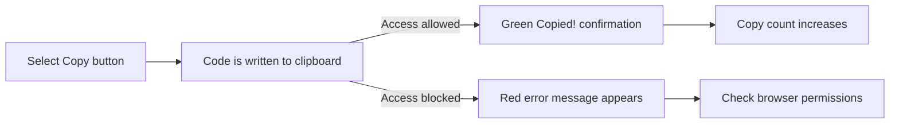

# Copy to clipboard

Copy to Clipboard lets you copy a snippet's code to your system clipboard with one click. Instead of dragging to select code and pressing a keyboard shortcut, you can grab the full contents of a snippet and paste it directly into an editor, terminal, chat, or document.

This feature is for anyone who regularly moves saved code or Markdown between CodeKnit and another tool. It saves time, avoids mistakes from partial selection, and works entirely without switching your hands to the keyboard.

## Where to find the copy controls

You can copy a snippet from two places:

- On a snippet card in the library, the **Copy** button appears in the bottom-right corner of the card.
- In the snippet detail view, the **Copy code** button appears in the action row near the bottom of the dialog.

Both controls behave the same way and copy the entire snippet code, not just the visible portion.

## What happens when you copy

The diagram shows the success and failure paths for a copy action.

Figure: Copy success and failure flow

When copying succeeds, CodeKnit updates the button label from **Copy** to **Copied!** and swaps the copy icon for a check mark. A green toast notification also appears to confirm the copy worked.

When copying fails, a red error toast explains that clipboard access was blocked or unavailable. The snippet itself is not changed.

## Usage tracking

Every successful copy is recorded for the snippet. You can see this in a few places:

- Snippet cards show a **Copied N times** note under the timestamp, next to the action buttons.
- The detail view shows **Copied N times** together with a **Last copied** date.
- The **Recently Used** section in the sidebar lists snippets that have been copied, ordered with the most recently copied first.

> [!NOTE]
> Copy tracking only updates after a successful copy. If the clipboard is blocked or the copy fails, the count does not increase.

## Related

- [Snippet Library](doc:9f431e10-b005-4cc0-80b1-0af4acdcb3d8)
- [Favorites](doc:b66c5560-9b68-42eb-922d-a8aecab0dfcb)
- [Search and Filter](doc:3704cb56-cf68-421d-9db0-d3816a8af756)
- [Dashboard](doc:0cccb845-62f3-4e2b-b0ca-c7d768eaf700)
