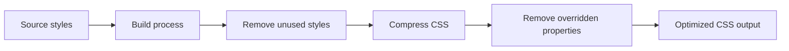
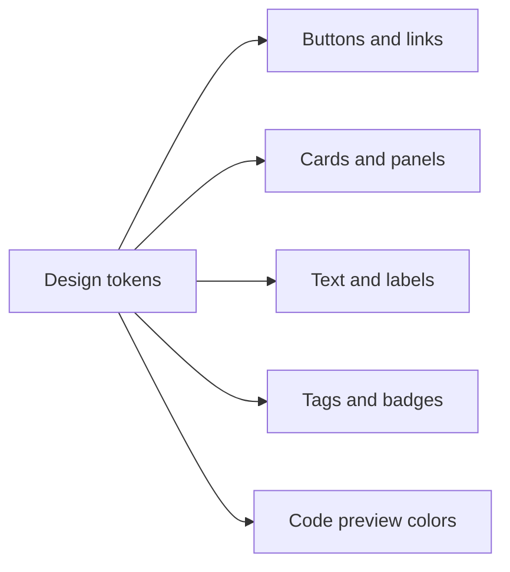

# CSS optimization

CSS Optimization keeps the visual styling of your app fast and efficient. When you prepare the app for release, the build process automatically removes styling that isn't needed and compresses the CSS that remains. This means visitors download smaller files and pages appear more quickly.

## Who it's for

CSS Optimization works automatically for developers who build and deploy the app. You don't need to configure anything to benefit from it. Content authors, site visitors, and other users experience the results, faster page loads and snappier interactions, without needing to understand how it works.

## What it does

When you build the app for production, three things happen:

- **Unused styles are removed.** The build analyzes which styling rules are actually used and drops the rest. If a design element isn't referenced anywhere in the app, its styles never make it into the final output.

- **CSS is compressed.** All styling files are shrunk by removing unnecessary spaces, line breaks, and other formatting that browsers don't need.

- **Custom properties are consolidated.** Design tokens such as colors, spacing, and borders are stored as reusable variables. When a variable is overridden by another rule, the build removes the overridden version and keeps only the final value. Duplicate or unnecessary variables never reach the browser.

Figure: Production build CSS optimization flow

## Benefits

- **Faster loading pages.** Smaller CSS files take less time to download, especially on mobile connections or slower networks.
- **Simplified styling output.** The final CSS contains only what the app actually uses, making it easier to inspect and reason about.
- **Consistent design.** The build keeps cross-referenced design tokens consistent, if one rule overrides another, only the winning value is shipped to users.
- **No manual effort.** Optimization happens automatically as part of the production build. You don't need to write special rules or maintain a list of what to remove.

## Key options and limits

| Option or limit | What it means |
| --- | --- |
| Automatic optimization | Runs during production builds without any manual steps. |
| Design token dependency | Custom properties are kept when they're still in use; only overridden or unreferenced ones are removed. |
| Build-time only | Optimization happens when the app is built, not while you're working in a development environment. Previewing changes during development doesn't trigger the full cleanup. |
| No visual changes | Removing unused or overridden styles doesn't affect how the app looks. The final appearance matches what was designed. |

## Understanding the visual design system

The app uses a shared set of design tokens, named values for things like background color, text color, borders, and highlights. Components throughout the app refer to these tokens by name rather than hard-coded color values. This makes the whole interface consistent and allows the optimizer to work efficiently.

The main design tokens include:

- **Primary colors** for buttons, highlights, and active elements
- **Secondary and muted colors** for supporting text, labels, and hover states
- **Accent colors** for tags, badges, and decorative elements
- **Card and border styling** for panels, dialogs, and dividers
- **Code-specific colors** for the snippet editor and preview, such as syntax highlighting for keywords, strings, comments, and numbers

Figure: Design tokens mapped to interface elements

## Related

- [Site Building & Bundling](doc:0fcd8337-ee59-484f-bda3-4db080caa340), Learn how the app is compiled and prepared for release
- [Syntax Highlighting](doc:0cc5fd84-0d94-4faf-ab51-00f580e726a4), Discover the styling used in the snippet editor and code preview
- [Performance Optimization](doc:df7d4ea6-c89c-4a8f-b056-db5fba77362b), Explore additional build optimizations that speed up page loads
- [Dashboard](doc:0cccb845-62f3-4e2b-b0ca-c7d768eaf700), See how the optimized interface presents your snippet library
