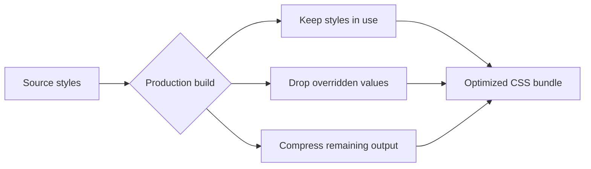

# CSS optimization

CSS Optimization makes your site load faster by shrinking the style information visitors download with every page. It runs automatically during production builds and works silently in the background: unused styles are removed, remaining styles are compressed, and redundant property definitions are cleaned up. This feature is for developers and site maintainers who care about page speed without spending time manually pruning style sheets.

## What CSS optimization does

When you publish your site, the build process examines every style rule and keeps only what affects how pages actually look:

- **Removes unused styles.** Rules that no page or component applies are discarded.
- **Cleans up overridden custom properties.** When the same property is set more than once and an earlier value is always replaced by a later one, the earlier declaration is dropped. Only the value that takes effect stays in the bundle.
- **Compresses the remaining output.** Spaces, comments, and human-friendly formatting are stripped away, leaving the smallest files a browser can still read.

Figure: How styles become an optimized CSS bundle during a production build

## Who it's for

CSS Optimization is for developers and site maintainers. You benefit every time you build the site for production—there is no extra step to remember. If you want more control, you can tune build settings to adjust how aggressively the optimizer removes unused or overridden styles.

## Benefits

- **Faster page loads.** Smaller style files download faster, especially on mobile networks.
- **Lower bandwidth use.** Visitors transfer less data on every visit.
- **No manual cleanup.** You don't need to hunt down dead rules by hand.
- **Consistent output.** The same source styles always produce the same optimized bundle.

## Key options

Optimization is on by default for production builds. You can also refine how it behaves:

- **Minify CSS for production.** Build the site in production mode to apply compression automatically.
- **Optimize CSS bundle size.** Target modern browsers in the build settings so the optimizer keeps only syntax those browsers need.
- **Remove unnecessary custom properties.** Enable cleanup of overridden custom properties through the build configuration. The optimizer removes only properties it proves are always overridden, so the visual result is unchanged.

## Limits

- Optimization applies only to production builds. Development builds keep styles uncompressed so they are easier to read and debug.
- Overridden-property removal is conservative. The optimizer never changes how a page looks—it only removes declarations that are guaranteed to be overridden.
- The optimizer modifies the output bundle, not your source style files. Your original styles remain untouched.

## Related pages

- [How to minify CSS assets for production](doc:ecfad4a4-133c-46ec-ac33-4d5b0d637ab3)
- [How to optimize CSS bundle size](doc:2d848518-523f-4344-b3fb-b15f92a93dff)
- [How to remove unnecessary custom properties from CSS](doc:f6703bac-6f8f-4846-a7c2-29c97692c058)
