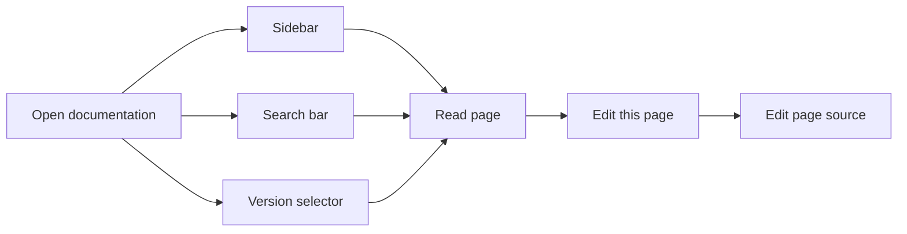
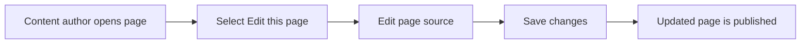

# Documentation

Documentation is the knowledge hub of the site. It holds the guides, references, and how-to material that help people learn. It is designed for two main groups: **site visitors** who read the material, and **content authors** who keep it accurate.

With documentation you can browse organized pages from a sidebar, search across published content, switch between versions, and open a page's source for editing.

## Who it is for

- **Site visitors** read documentation to learn how things work. They move around with the sidebar, search bar, and version selector.
- **Content authors** keep documentation accurate by editing pages through the **Edit this page** link.
- **Site administrators** shape the documentation structure: what appears in the sidebar, how pages are organized, and which languages are supported.

## What you can do

### Browse documentation from the sidebar

The sidebar is the main way to move through documentation. It lists available pages in a structured, predictable order. Select any title in the sidebar to open that page.

### Search documentation content

The documentation search bar accepts keywords and returns matching pages. Use it when you know what you are looking for but are not sure where it lives.

### Navigate versioned documentation sets

When documentation is published in more than one version, a **Version selector** appears. Use it to switch between versions, such as an older release and the current release.

### Edit a page from its source link

Each documentation page can include an **Edit this page** link. Selecting it opens the page's editable source so a content author can make updates.

### Configure the sidebar and paths

Site administrators decide what appears in the sidebar and how documentation is organized. They can define the page order, the sidebar structure, and the URL path layout.

### Localize documentation paths

Site administrators can provide localized versions of documentation paths for additional languages.

## Benefits

- **Faster learning**, visitors find what they need through structured navigation and search.
- **Up-to-date content**, content authors can jump straight from a published page to its source.
- **Version safety**, visitors can consult documentation that matches the release they are using.
- **Consistent organization**, administrators keep the sidebar ordered and predictable.

## Key options and limits

Options include:

- Sidebar organization and page order
- Documentation path structure
- Localized paths for additional languages
- Multiple documentation versions with a version selector
- Built-in search across documentation content

Limits to keep in mind:

- Search results depend on the documentation content that has been published.
- Available versions depend on how the site administrator configures versioning.
- The **Edit this page** link behaves differently depending on whether the page source is editable and connected.

> [!NOTE]
> The **Version selector** only appears when the site publishes more than one version of documentation.

## How the main flows fit together

The diagram below shows the main ways a site visitor moves through documentation.

Figure: Documentation browsing flow

The next diagram shows the path a content author follows to update documentation.

Figure: Content author update flow

## Related pages

- [Browse documentation by sidebar](doc:526a2eef-f1ec-498a-ba05-8f9a60a0241a)
- [Search documentation content](doc:618bed8b-55ea-4ed4-9526-f90adade00c3)
- [Navigate versioned documentation sets](doc:86645afe-97a4-4658-b7b5-fd86cd1aba8d)
- [Edit current page via source link](doc:c89514ca-39c3-485a-a4a8-8f44f0ac3293)
- [Configure documentation sidebar and paths](doc:85ed333a-1d37-4f3a-bf1e-57ed829c2fb1)
- [Localize documentation paths](doc:49b3b32b-6eb1-42f5-96f7-5482cd7208e6)
