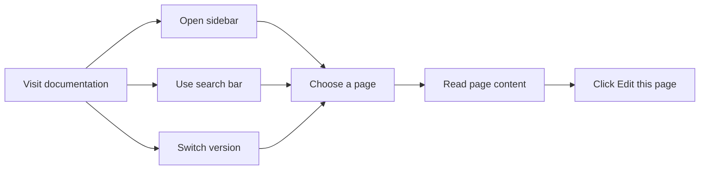
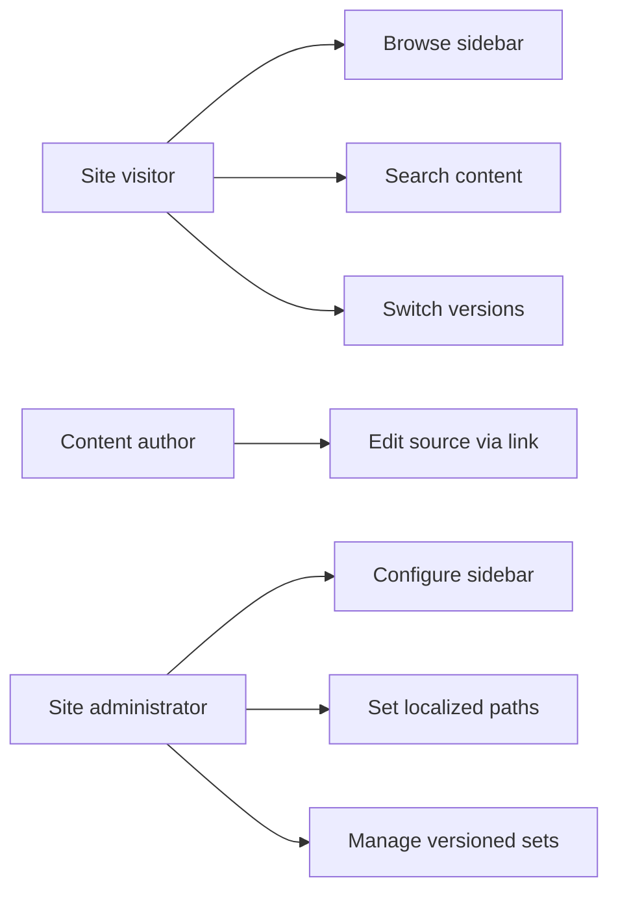

# Documentation

Create and organize documentation sites with versioned content, searchable pages, navigable sidebars, and direct links back to source for editing.

## At a glance

The Documentation feature provides a complete system for publishing and reading documentation. Site visitors can browse and search pages, switch between documentation versions, and follow a structured sidebar. Content authors can publish updates by editing source content, and site administrators can configure how the sidebar, paths, and localized routes are organized.

Documentation is useful for:

- **Site visitors** who need to learn, navigate, and search documentation
- **Content authors** who write and update pages
- **Site administrators** who configure sidebar structure, path routing, and language support

## What you can do

### Browse by sidebar

Pages are organized into a navigable sidebar that groups related topics. Open the sidebar, choose a page, and content appears in the reading area. This is the primary way to explore structured documentation.

### Navigate versioned documentation sets

When documentation is versioned, a version selector lets you switch between snapshots of content. Each version has its own set of pages and sidebar, so you can consult the version that matches the product version you're using.

### Search documentation content

A search bar accepts free-text queries and returns matching documentation pages. Search helps you find content when you don't know where it lives in the sidebar.

### Edit the current page from a source link

Each page includes an **Edit this page** link that takes content authors directly to the source content for that page, making it easy to propose or publish corrections.

### Localize documentation paths

Site administrators can define localized versions of documentation paths, so the same documentation set can serve multiple languages with language-specific URLs.

## Understanding the flow

The diagram below shows the typical journey when a visitor uses the Documentation feature.

Figure: Documentation browsing flow

## Key options

- **Version selector** for choosing among available documentation sets
- **Sidebar grouping** for organizing pages into navigable sections
- **Search bar** for full-text page discovery
- **Edit this page link** for quick content updates
- **Localized paths** for multilingual documentation

## Capabilities for each role

Site visitors, content authors, and site administrators use Documentation differently. The diagram below summarizes the capabilities available to each group.

Figure: Documentation capabilities by role

## Benefits

- **Structured navigation**, sidebars group related topics so visitors always know where they are
- **Versioned content**, readers can access older or newer documentation sets without losing context
- **Fast discovery**, full-text search finds pages that may be buried in the sidebar
- **Streamlined edits**, content authors can jump from a page directly to its source to make updates
- **Multilingual reach**, localized paths let one documentation workflow support multiple languages

## Limits

The Documentation feature covers the capabilities above; it does not provide analytics, access control, or workflow approval for published changes. Available configuration options are limited to the settings described in the related guides.

## Related

- [How to browse documentation by sidebar](doc:526a2eef-f1ec-498a-ba05-8f9a60a0241a)
- [How to configure documentation sidebar and paths](doc:85ed333a-1d37-4f3a-bf1e-57ed829c2fb1)
- [How to edit current page via source link](doc:c89514ca-39c3-485a-a4a8-8f44f0ac3293)
- [How to localize documentation paths](doc:49b3b32b-6eb1-42f5-96f7-5482cd7208e6)
- [How to navigate versioned documentation sets](doc:86645afe-97a4-4658-b7b5-fd86cd1aba8d)
- [How to search documentation content](doc:618bed8b-55ea-4ed4-9526-f90adade00c3)
