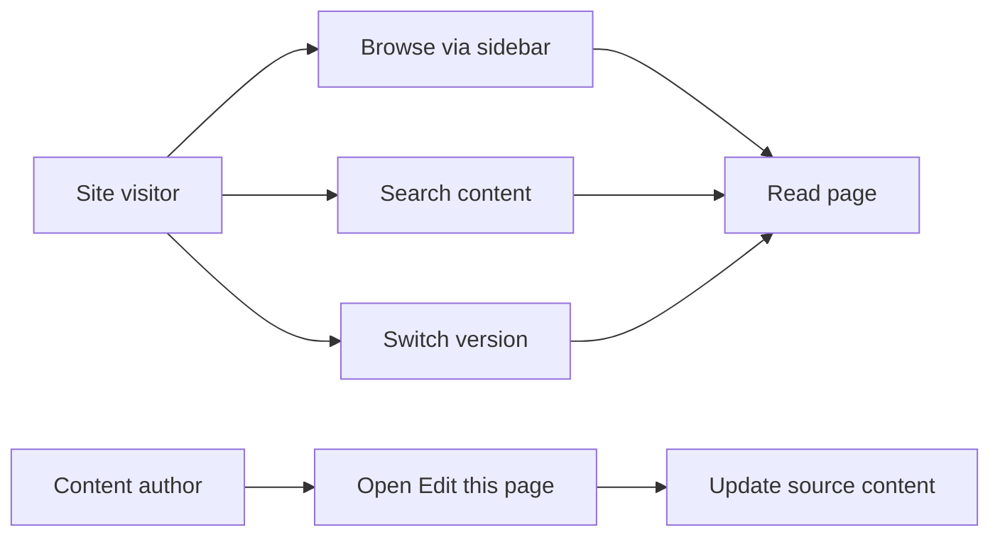

# Documentation

Documentation is the organized set of pages that help site visitors find answers and complete tasks. It brings written content together with navigation tools—sidebars, search, version selection, and page-edit links—so visitors can learn quickly and content authors can keep pages current.

## Who it's for

Documentation serves two audiences:

- **Site visitors** who browse, search, and read published articles.
- **Content authors** who create, update, and localize documentation pages.

## Core capabilities

Documentation makes content easier to discover, read, and maintain.

### Sidebar navigation

Visitors browse documentation through the sidebar. The sidebar groups related pages into organized sections and shows the structure of the documentation set at a glance. Site administrators can configure which page groups appear and how paths are organized.

### Content search

Visitors can search across documentation content using the search bar. Search helps people jump directly to a relevant page without needing to browse the sidebar.

### Versioned documentation sets

When a documentation site publishes more than one version, visitors can switch between versions using a version selector. Older release guidance remains available alongside the current documentation.

### Edit this page links

Content authors can open the source file for the current page directly from an **Edit this page** link. This reduces the effort needed to locate and update content.

### Localized documentation paths

Site administrators can localize documentation paths so translated versions of pages appear under language-specific sections.

Figure: Documentation visitor and author flow

## Key options

Documentation provides these main choices:

- **Navigation**: browse pages by sidebar section, search across content, and switch between published versions
- **Organization**: configure sidebar order, page groups, and paths
- **Localization**: present translated documentation under localized paths
- **Editing**: open the source for the current page through an edit link

## Limits

Some behavior depends on how the documentation site is configured:

- Version switching is available only when multiple documentation versions are published.
- Search results are limited to the content the site has indexed.
- Edit links appear only when the current page has an associated source file.
- Localized paths require configuration by a site administrator.

## How-to guides

- [How to browse documentation by sidebar](doc:526a2eef-f1ec-498a-ba05-8f9a60a0241a)
- [How to search documentation content](doc:618bed8b-55ea-4ed4-9526-f90adade00c3)
- [How to navigate versioned documentation sets](doc:86645afe-97a4-4658-b7b5-fd86cd1aba8d)
- [How to edit current page via source link](doc:c89514ca-39c3-485a-a4a8-8f44f0ac3293)
- [How to configure documentation sidebar and paths](doc:85ed333a-1d37-4f3a-bf1e-57ed829c2fb1)
- [How to localize documentation paths](doc:49b3b32b-6eb1-42f5-96f7-5482cd7208e6)
