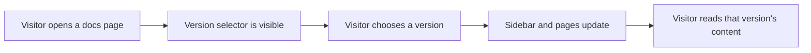
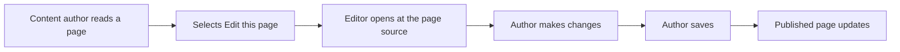

# Documentation

Documentation is the central home for your product's written content. It brings articles, guides, and reference material together into a structured site that visitors can browse, search, and navigate by version. Content authors maintain the material, and site administrators control how it is organized and presented.

## Who it's for

Documentation serves three groups of people:

- **Site visitors** read the published documentation to learn how to use the product and find answers to their questions.
- **Content authors** write, update, and organize the articles and guides that visitors read.
- **Site administrators** configure the documentation structure, search settings, localized paths, and version sets.

## Core capabilities

### Browsing by sidebar

Visitors navigate documentation through a sidebar that groups related pages into sections. The sidebar shows where you are in the documentation and lets you jump between topics without losing your place. The sidebar structure is defined by the site administrator, so it always reflects the organization of the current documentation set.

### Full-text search

The search bar scans documentation content and returns matching pages. Visitors can find a specific topic by typing keywords, rather than browsing the sidebar manually. Search covers the published documentation content for the current site.

### Versioned documentation sets

Documentation can be organized into multiple versions. Visitors select a version from the version selector to read documentation that matches a particular release of the product. Each version has its own set of pages, sidebar, and content, so older documentation remains available alongside newer material.

Figure: Version selection flow

### Edit this page links

Each documentation page can include a link that takes the content author directly to the editor for that page. The author makes a change, saves it, and the published page reflects the update. This keeps the distance between reading and editing small.

Figure: Edit page flow

### Sidebar and path configuration

Site administrators define the sidebar structure and documentation paths. This includes which sections appear, how pages are grouped, and what URLs visitors use to reach each page. Changes to this configuration affect how all visitors experience the documentation.

### Localized paths

Documentation paths can be configured for different languages. Site administrators can set up localized documentation paths so that visitors in different locales see content at language-appropriate URLs.

## Benefits

Documentation brings together reading, searching, versioning, and editing in one place. Visitors spend less time hunting for information because the sidebar and search work together. Content authors have a direct path from a published page to its source. Site administrators retain control over organization, localization, and version availability.

## Limits

Documentation content must be written and maintained by content authors; the documentation site itself does not generate articles. Search covers published documentation content and depends on the current site's search configuration. Versioned documentation requires the site administrator to set up and maintain each version. Localized paths require the site administrator to configure locale-specific paths.

> [!NOTE]
> The documentation site and its configuration are managed by site administrators and content authors. Visitors interact with the published result.

## Related guides

- [How to browse documentation by sidebar](doc:526a2eef-f1ec-498a-ba05-8f9a60a0241a)
- [How to search documentation content](doc:618bed8b-55ea-4ed4-9526-f90adade00c3)
- [How to navigate versioned documentation sets](doc:86645afe-97a4-4658-b7b5-fd86cd1aba8d)
- [How to edit current page via source link](doc:c89514ca-39c3-485a-a4a8-8f44f0ac3293)
- [How to configure documentation sidebar and paths](doc:85ed333a-1d37-4f3a-bf1e-57ed829c2fb1)
- [How to localize documentation paths](doc:49b3b32b-6eb1-42f5-96f7-5482cd7208e6)
