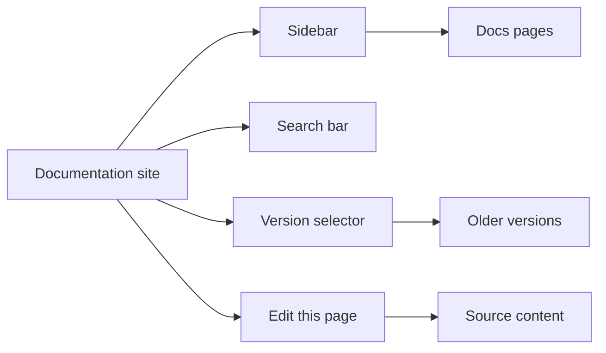
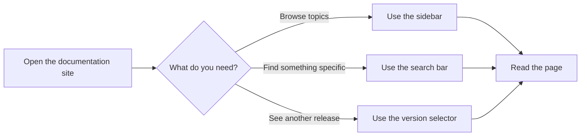

# Documentation

**Documentation** helps you publish, organize, and navigate a knowledge site. It gives site visitors a clear way to find and read content, while giving content authors and site administrators the tools to keep that content structured, searchable, and up to date.

## Who it's for

Documentation is built for three groups:

- **Site visitors** who want to read, search, and browse published content.
- **Content authors** who write and maintain the pages.
- **Site administrators** who configure navigation, versions, and paths.

## What you can do

### Browse content from a sidebar

The sidebar organizes documentation into sections and pages. As a site visitor, you select a section to open its pages. This gives every page a predictable place to live and makes related content easy to find.

Administrators can configure which pages appear in the sidebar and in what order. That means a growing documentation site stays organized instead of becoming a flat list of links.

### Search documentation content

The search bar lets visitors find a page without knowing where it lives in the sidebar. You type a term and the site returns matching documentation content.

Search is the fastest path when you already know what you're looking for but not where it's stored.

### Switch between documentation versions

A version selector lets visitors move between different releases of the documentation. Each version keeps its own set of pages, so older content remains available when a new version is published.

This matters for products with multiple supported releases. A reader can consult the docs that match the release they actually use.

### Edit a page from the page itself

Each page can include an **Edit this page** link. When a content author spots a correction or improvement, they select the link and go straight to the source content for that page.

This shortens the path from "I found a problem" to "I fixed it," which helps documentation stay accurate.

### Support multiple languages

Documentation paths can be localized, so visitors can read content in their language and administrators can manage localized page locations.

### Configure how the site is organized

Site administrators can configure the sidebar and documentation paths. This controls how content is grouped, what appears in navigation, and where pages are located.

## How the pieces fit together

The diagram below shows the main parts of a documentation site from a visitor's perspective.

Figure: Main parts of a documentation site

When you arrive at a documentation site, you can follow the sidebar to browse, use search to find something specific, or switch versions to see content for another release. The **Edit this page** option is available to content authors who want to improve the current page.

Figure: Choosing how to find documentation

## Benefits

- Visitors find answers faster because content is organized, searchable, and versioned.
- Content authors can fix pages quickly through the **Edit this page** link.
- Site administrators can keep navigation clean as the site grows.
- Maintaining separate versioned sets preserves access to older documentation.
- Localized paths make content accessible to readers in multiple languages.

## Key options and limits

- Versioned documentation keeps each release in a separate set. Content must be maintained in each version where it should appear.
- Search and sidebar navigation depend on how the site is configured. If content isn't included or indexed, visitors won't find it.
- Edit links take content authors to the source page, but the publishing workflow itself is separate.
- Localized paths require configuration before visitors can navigate to localized pages.

> [!NOTE]
> Version sets are independent. Updating content in one version does not automatically update it in another.

## Related

- [How to browse documentation by sidebar](doc:526a2eef-f1ec-498a-ba05-8f9a60a0241a)
- [How to search documentation content](doc:618bed8b-55ea-4ed4-9526-f90adade00c3)
- [How to navigate versioned documentation sets](doc:86645afe-97a4-4658-b7b5-fd86cd1aba8d)
- [How to edit current page via source link](doc:c89514ca-39c3-485a-a4a8-8f44f0ac3293)
- [How to configure documentation sidebar and paths](doc:85ed333a-1d37-4f3a-bf1e-57ed829c2fb1)
- [How to localize documentation paths](doc:49b3b32b-6eb1-42f5-96f7-5482cd7208e6)
