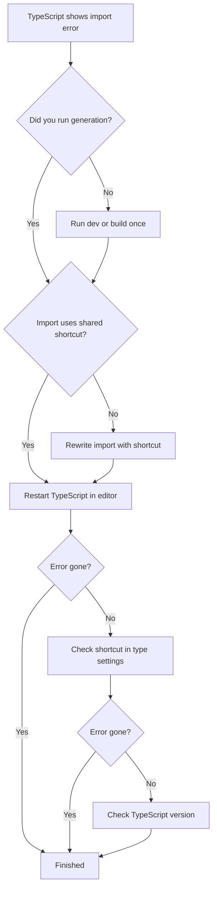

# How to avoid TypeScript errors when importing generated modules

This guide helps you prevent and fix TypeScript errors such as “Cannot find module” when you import modules that the project generates automatically. You’ll learn how to generate modules before importing, use the project’s shared import style consistently, and refresh TypeScript after the project produces new modules.

## About generated modules and the shared import shortcut

When you run this project, the tooling generates routing-related modules for you instead of requiring you to write them by hand. Every internal import in this project uses one shared shortcut: the`@/` prefix. The project also includes`vite-tsconfig-paths`, a helper that lets the build tooling read the same shortcut and path list that TypeScript reads. Use the same`@/` prefix for generated modules so both the editor and the build tool agree on where to find them.

The following checks show what to verify when an import error appears:

Figure: Checks for resolving TypeScript import errors

## Step-by-step

### 2. Use the shared import shortcut

Use the same`@/` prefix that the rest of the project uses for internal imports. If you use a plain filename or a different relative form, TypeScript may report “Cannot find module” even when the generated module exists.

> [!NOTE]
> Keeping every internal import on the same shortcut is important because the build tooling and the TypeScript editor must read the same location list. A mismatch causes errors that appear only in the editor or only at build time.

### 3. Restart the TypeScript server in your editor

Editors cache the list of modules they know about. After the project generates or changes a module, you need to reload that list.

1. Open the command palette in your editor.
2. Choose **TypeScript: Restart TS Server** in VS Code, or the equivalent command in your editor.
3. Wait a few seconds for the editor to scan the project again.

### 4. Verify the shortcut in TypeScript settings

If TypeScript still cannot find the module:

1. Open your editor’s TypeScript settings for this project.
2. Confirm that the`@/` prefix appears under`paths`.
3. Make sure the generated module location isn’t excluded from TypeScript checking.

The`@/` prefix must be declared in the settings that TypeScript and the editor read, not only in the build tooling.

### 5. Select the workspace TypeScript version

This project specifies TypeScript 5.8.3. If your editor is using a different TypeScript version, import resolution can behave differently.

1. In VS Code, open the command palette and choose **TypeScript: Select TypeScript Version**.
2. Choose **Use Workspace Version**.
3. Restart the TypeScript server again if your editor asks for it.

## Expected result

After completing these steps, the red error marker on the import is gone, the editor offers autocompletion for the generated module, and the project continues to run without import errors.

## Common issues

- **The error remains after generation.** Restart the TypeScript server again. The editor often needs a second reload after the generator writes new files.
- **The project runs, but the editor still shows an error.** This usually means the editor and the build tool are reading different shortcut settings. Verify the`@/` prefix in your TypeScript settings.
- **The newly generated module never appears.** Stop the development server, run the generation command again, and then restart TypeScript.

## Related

- [TypeScript Module Aliases](doc:c7895a4c-96bd-4426-934c-73fc2ba9791e)
- [How to type custom theme components and plugins](doc:20b0c01d-fe91-40e8-a71c-c3b200c8c4c1)
- [How to debug errors with detailed context](doc:a9ead17d-7cce-4ed8-b0e6-f8578ab70072)
