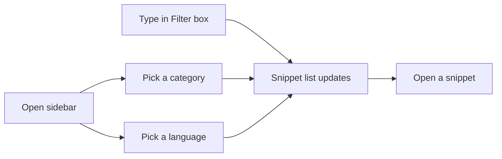

# How to browse posts by author

This guide explains how to browse posts by author in the Blog area. In the current product build, the Blog area and author pages are not included, so this workflow is not yet available.

> [!IMPORTANT]
> If you do not see a Blog area or an author name anywhere in the product, your installed version does not include author browsing yet. The steps below describe the browsing features that are available today.

## What you can browse today

The current product focuses on saving and finding code and text snippets. You can browse snippets by topic using the navigation sidebar and filter controls.

### Browse by category

1. Open the navigation sidebar.
2. Under **Categories**, select the category you want.
3. The snippet list updates to show only snippets in that category.

### Browse by language

1. Open the navigation sidebar.
2. Under **Languages**, select a language.
3. The snippet list updates to show only snippets written in that language.

### Use filters

1. In the main area, type into the **Filter** box to search titles, tags, or content.
2. Use the **Language filter**, **Category filter**, and **Tag filter** dropdowns to narrow the list.
3. Use the **Sort** dropdown to order snippets by newest, oldest, or name.
4. If you applied filters and want to start over, select **Clear Filters**.

Figure: Browsing snippets without author pages

> [!NOTE]
> The number of snippets currently shown appears near the top of the list, so you always know how many results match your selection.

## Expected result with author browsing

When author pages are added to the Blog area, opening an author's name on a post would show a list of posts written by that author. From there, selecting any post would open it for reading. This workflow is planned but not present in the current version.

## Common issue

- **I don't see any author name or author page.** The Blog area is not part of the current build. A product update that adds Blog support is required before you can browse posts by author.

## Related

- [Blog](doc:9ee63f83-3e40-49be-87bd-7b6a57c9a4c9)
- [How to read blog posts](doc:8dec29d4-914f-42c1-ad4a-58b3923066cd)
- [How to filter posts by tags](doc:da9e186e-2e74-4c49-9554-769d57a8aa79)
- [Search and Filter](doc:3704cb56-cf68-421d-9db0-d3816a8af756)
