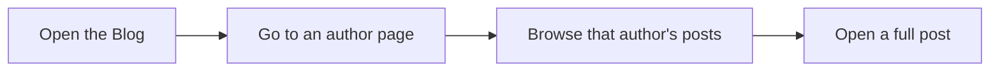

# How to browse posts by author

Browse all blog posts from one writer by opening that writer's author page. This is part of the Blog feature, which is designed for blog readers and content authors.

## What you'll need

- Access to the Blog area.
- A blog post that shows an author name, or a link to an author page from the blog navigation.

## Browse posts by author

Figure: Browsing posts by author

1. Open the **Blog** listing page.
2. Select a post to open it.
3. On the post, locate the author name near the title or in the post details.
4. Select the author name.
5. On the author page that opens, browse the posts shown for that author.
6. Select any post title to read the full post.

## Expected result

You land on an author page that lists the posts published by that author. Each listed post links to the full post.

> [!NOTE]
> The exact wording and placement of author links can differ between blog themes. Use the links shown on the post or in the Blog navigation to reach author pages.

## Common issues

- **The author name isn't selectable.** The blog may not have author pages enabled, or the post may not have an assigned author. Ask a content author or site administrator to check the post.
- **The author page is empty or shows few posts.** The author page shows only the posts assigned to that author. If a writer has not published many posts, the list will be short. Try another author to compare.

## Related

- [What Blog is and who it is for](doc:9ee63f83-3e40-49be-87bd-7b6a57c9a4c9)
- [How to read blog posts](doc:8dec29d4-914f-42c1-ad4a-58b3923066cd)
- [How to filter posts by tags](doc:da9e186e-2e74-4c49-9554-769d57a8aa79)
- [How to paginate through blog listing](doc:cad40b05-f8e4-461f-8d6d-f8d68130ab6d)
- [How to subscribe to RSS/Atom feed](doc:33a9a7d1-25c6-4d6c-a982-408eb7ab60c1)
