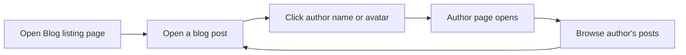

# How to browse posts by author

You can find every post written by a particular author by opening their author page. An author page gathers all of that author's published posts in one place, so you can read related articles without searching through the whole blog.

## Prerequisites

- A published blog is available from the site's main navigation.
- At least one blog post has author information attached to it.

## Steps

1. Open the **Blog** from the site's main navigation.
2. On the **Blog listing page**, click a post that interests you.
3. In the open post, look for the author's name and avatar, usually shown near the post title or at the end of the article.
4. Click the author's name or avatar.
5. The **Author page** opens and shows every post attributed to that author.
6. Browse the listed posts. Click any post title to open and read that article.

Figure: How a blog reader reaches an author page and browses its posts

## Expected result

You land on an author page that identifies the author and lists their published posts. From that page, you can open any listed post directly and read it in full.

## Common issues

- **The author page appears empty.** The selected author may not have any published posts yet. Check back after new content is posted.
- **The author's name does not respond when clicked.** The post may not have complete author details. Contact the content author or site owner to update the post's author information.
- **You cannot find an author page from the blog listing.** Open a specific post first. Author pages are usually reached by clicking the author's name from within an individual post.

> [!NOTE]
> If more than one author shares the same name, use the author page's avatar or bio to confirm you are viewing posts from the right person.

## Related

- [Read blog posts](doc:8dec29d4-914f-42c1-ad4a-58b3923066cd)
- [Filter posts by tags](doc:da9e186e-2e74-4c49-9554-769d57a8aa79)
- [Paginate through blog listing](doc:cad40b05-f8e4-461f-8d6d-f8d68130ab6d)
- [Blog](doc:9ee63f83-3e40-49be-87bd-7b6a57c9a4c9)
