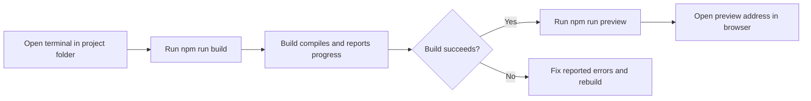

# How to build the production site

Build the production-ready version of your site with one command, then preview it locally before you deploy it.

## Steps

1. Open a terminal in the project folder.
2. Run`npm run build`.
3. Wait for the build to finish. The terminal shows progress and ends with a success message.
4. Run`npm run preview` to serve the production build locally.
5. Open the address shown in the terminal in your browser to check the production site.

Figure: Production build and preview flow

## Next steps

- [Product Overview](doc:ca8f433d-53d1-475b-a3a5-29b24f1ba173)
- [Site Building & Bundling](doc:0fcd8337-ee59-484f-bda3-4db080caa340)
