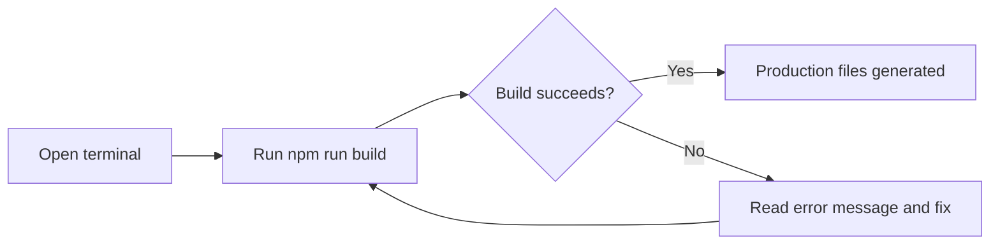
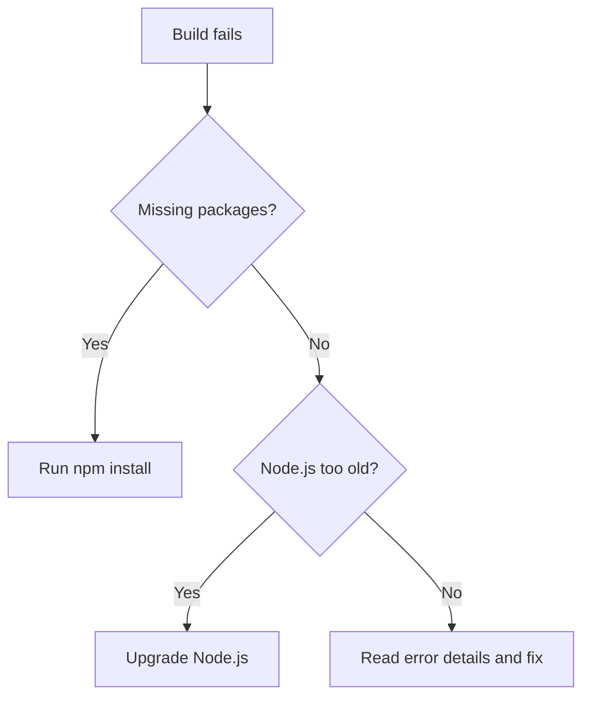

# How to build the production site

This guide shows you how to create an optimized production build of your site and preview it locally before you publish it.

## Build the production site

1. Open a terminal in your project folder.
2. Run the production build command:

```sh
   npm run build
   ```

3. Wait for the build to finish. A successful build prints a summary of the generated files.

Figure: Production build flow


## Common issues

Figure: Build failure troubleshooting


- **Dependencies not installed**: If the build can't find packages, run`npm install` first, then try again.
- **Outdated Node.js**: Some build tools require a recent Node version. Upgrade Node.js if the build reports an unsupported version error.
- **File-specific errors**: When the build fails on a specific file, the error output names that file. Fix the problem there and run`npm run build` again.

## Related

- [Site Building & Bundling](doc:0fcd8337-ee59-484f-bda3-4db080caa340)
- System Requirements and Installation
- [Product Overview](doc:ca8f433d-53d1-475b-a3a5-29b24f1ba173)
