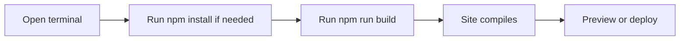

# How to build the production site

This guide walks you through creating an optimized, ready-to-deploy version of your site.

## Prerequisites

Before you begin, make sure you have:

- Node.js and npm installed on your computer. If you haven't installed them yet, use nvm to set them up.
- The project files on your computer.
- Dependencies installed from a previous setup step.

## Build the site

1. Open a terminal.
2. Navigate to the project folder.
3. If this is your first build, install dependencies:
```
   npm install
   ```
4. Run the production build:
```
   npm run build
   ```
5. Wait for the build to finish. The terminal shows progress messages while the site compiles.

Figure: Production build flow


## Expected result

- The site compiles without errors.
- The terminal shows a successful completion message.
- You can preview the built site locally or deploy it to a hosting service.

## Related

- [System requirements and installation](doc:1016cd5f-d53c-46d7-a74a-15b623ef5387)
- [Site building and bundling](doc:0fcd8337-ee59-484f-bda3-4db080caa340)
- [How to enable faster build mode](doc:c4b28fd3-840d-4199-8d25-b0db7d1b0e49)
- [How to measure build performance and memory usage](doc:2b46c98f-8208-4348-b81b-fbe839c07966)
