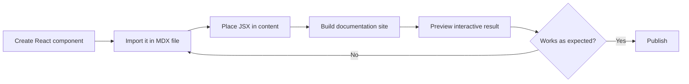

# How to embed interactive react components in MDX

This guide shows you, as a developer, how to place interactive React components directly inside MDX content files so readers can click, type, toggle, or explore without leaving the page.

## What you can achieve

MDX lets you mix Markdown text with live React components. Instead of writing a static description of a feature, you can drop in a working component, such as a button, tabbed panel, or accordion, and let readers interact with it right on the published page.

## Prerequisites

Before you start, make sure you can:

- Edit`.mdx` content files in your project
- Create or locate React components in your codebase
- Build the documentation site locally to preview changes

> [!NOTE]
> Interactive components run in the reader's browser. Keep components self-contained and avoid relying on server-only data unless that data is available to every visitor.

Figure: Embedding a React component in MDX

## Steps

1. **Create your React component** in your project using your normal component conventions. For example, a small counter, a disclosure panel, or a tabbed interface.

2. **Open the`.mdx` file** where you want the component to appear.

3. **Add an import statement at the top** of the file that brings the component into the page. Use the same import path you use elsewhere in the project.

4. **Place the component in the body of your content** using JSX syntax, exactly as you would inside a React render function. You can pass props to control labels, initial values, or styling.

5. **Continue writing Markdown around it.** MDX allows normal Markdown headings, lists, and paragraphs before and after the component.

6. **Build the documentation site** or start the local preview to see the component rendered on the page.

7. **Interact with the component in the browser.** Click its buttons, open its panels, or submit its forms to confirm it responds the way you expect.

8. **Fix any layout or behavior issues**, then rebuild and preview again until the component behaves correctly.

## Expected result

The published page shows your component fully interactive. Readers can use it without leaving the page, and surrounding Markdown continues to render as usual. The component respects the page's overall styling and is responsive to different screen sizes.

## Common issues

- **The component renders blank or causes the build to fail**, Check that the import path is correct and that the component file exists at that location. Also verify the component has no syntax errors.
- **The component appears, but nothing happens when you interact with it**, Interactive features require the component to manage its own state. Confirm the component uses browser-compatible state handling.
- **The component breaks the page layout on small screens**, Review the component's responsive behavior and adjust its container or internal styles if it overflows.
- **The page loads slowly**, Large or heavy components increase the browser workload. Split complex interfaces into smaller components or lazy-load non-essential parts.

## Related

- [MDX & Markdown Authoring](doc:8c883a2a-ae26-48ef-9a37-c40061a922af)
- [How to render Mermaid diagrams](doc:1e7891d7-ec3b-43fb-9ea5-78650c4fb27e)
- [How to write Markdown content with front matter](doc:f6c3013b-eeca-4de7-9e8b-1e5ec5433170)
- [How to validate front matter against schema](doc:b6e9bdac-0aa1-44bd-a2c2-2bea6c84b4a3)
- [Documentation](doc:7e97fe70-a638-4596-bb48-adfef8fb0b61)
