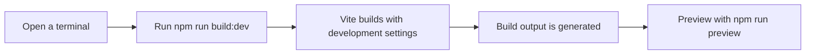

# How to enable faster build mode

Building the site repeatedly while you make changes can feel slow. This project provides a faster development build you can use for quick previews and local checks instead of waiting on the full production build.

Figure: Faster build flow

## Common issues

- **The command is not recognized**, Make sure you are in the project folder and that the project has`build:dev` listed in its available scripts.
- **The preview looks outdated**, Run`npm run build:dev` again before starting`npm run preview` to refresh the generated output.
- **You need a deployable build**, Use`npm run build` instead. The faster mode is intended for local testing and iteration, while the standard build produces the optimized production output.

> [!NOTE]
> This project also pins the Rolldown bundler to a compatible version through an override setting. You don't need to change that to use the faster build mode.

## Related

- [How to build production site](doc:23e09652-4772-4f32-a5b7-0121a8bc4853)
- [How to measure build performance and memory usage](doc:2b46c98f-8208-4348-b81b-fbe839c07966)
- [How to view build progress and status messages](doc:1c979433-c5bf-4e10-8e5c-5a4822d74c52)
- [Performance Optimization](doc:df7d4ea6-c89c-4a8f-b056-db5fba77362b)
