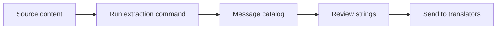
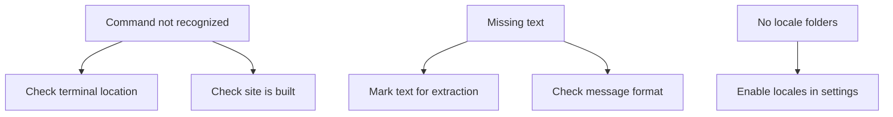

# How to extract translation messages from source code

Extract every piece of user-facing text from your site's source content so you can translate it into other languages. This guide walks you through running the extraction command, reviewing the output, and preparing the extracted messages for translation.

## What you can achieve

Running extraction scans your site's source files and collects all the text that visitors can see: navigation labels, buttons, page titles, and content written in your site's default language. The result is a single message catalog ready for translators or translation management tools.

## Prerequisites

Before you begin, make sure:

- Your site project is set up on your local machine
- You can open a terminal or command prompt
- You know where your site project folder lives

## How extraction works

The extraction process moves from source content to a translated catalog, passing through a review step where you can check what was found.

Figure: Translation extraction flow


## Extract translation messages

### 1. Open a terminal in your site folder

Navigate to the folder that contains your site project. This is the same folder where you run commands to start or build your site.

### 2. Run the extraction command

Type the following command and press Enter:

```bash
docusaurus write-translations
```

This command scans your source files, identifies every piece of translatable text, and writes the collected messages out to a translation catalog. You can run it again any time you add new content, and it will update the catalog without losing existing translations.

### 3. Review the output

The extraction creates a translation folder inside your site project. Each locale you've enabled gets its own subfolder containing the extracted messages.

Each extracted entry includes:

- **A stable ID** that stays the same across extraction runs
- **The original text** from your site's default language
- **A description** that tells translators where the message appears

Open the file and check that the messages look complete. Look for any text that should be translatable but didn't get picked up.

### 4. Check for newly detected messages

If you've added pages, labels, or interface text since your last extraction, the new messages are added to the catalog automatically. Previously translated messages are left untouched.

### 5. Hand off the extracted messages

Copy the extracted message catalog and share it with your translation team, or import it into your translation management platform. The catalog format is designed to work with common translation tools.

## Expected result

After the command finishes successfully, you will see:

- Terminal output confirming the extraction ran
- A translation catalog containing all user-facing text from your source content
- Existing translated messages preserved exactly as they were
- New messages added to the catalog without disrupting older entries

## Common issues and fixes

Use this decision flow when extraction doesn't go as expected.

Figure: Troubleshooting translation extraction


### The command isn't recognized

If your terminal reports that the command can't be found, confirm you're inside your site project folder. This command is part of the site tooling and won't run from any other directory.

### Translatable text doesn't show up

When a piece of text is missing from the extracted catalog, review how it appears in your source content. Some advanced content formats require explicit markers before their text is picked up during extraction.

### Locale folders weren't created

The extraction creates locale folders based on the languages turned on in your site settings. If expected locale folders are absent, check your site configuration to make sure those locales are enabled.

## Related

- [How to generate translation files for localization](doc:bbfd60e0-925b-40b3-bf9d-cf9a1cf239fe)
- [How to integrate extracted translations with translation management](doc:322bb9dc-cd16-43ee-8bf5-eda0be14aa8d)
- [Translation Extraction](doc:29cd6eff-ce01-4f01-a7ea-f21a8540b7bd)
- [How to localize documentation paths](doc:49b3b32b-6eb1-42f5-96f7-5482cd7208e6)
