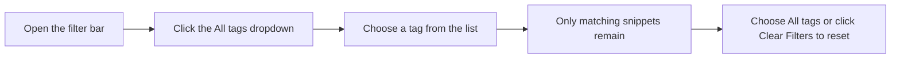

# How to filter snippets by tags

Filtering by tag helps you quickly narrow your library to saved snippets that share a topic, such as`#react`,`#api`, or`#testing`. The tag filter is part of the filter bar that appears on every page in your workspace.

## Prerequisites

- Your snippet library is open and has finished loading.
- At least one snippet already has a tag. Tags are added when you create or edit a snippet using the **Tags** field.

## Step-by-step instructions

1. Open **Dashboard**, **All Snippets**, or another view that shows your snippet list.
2. Locate the filter bar just below the page heading. It contains a search box and several dropdown filters.
3. Click the dropdown that shows **All tags** by default.
4. Choose the tag you want to filter by. Each tag appears with a`#` symbol in front of its name, for example`#react`.
5. The list updates immediately to show only snippets that carry the selected tag. The count next to the page heading updates to match.
6. To remove the filter, open the dropdown again and choose **All tags**, or click **Clear Filters** when it appears.

The following diagram shows the flow from opening the filter bar to resetting the tag filter.

Figure: Filtering snippets by a tag

## Expected result

- Only snippets that carry the selected tag appear in the list.
- Each visible snippet card shows the matching tag as a`#tag` chip.
- The **shown** count beside the heading reflects the narrowed results.

## Common issues

- **The tag you want is not in the dropdown**: the dropdown only lists tags that already exist on snippets in your library. Add the tag to at least one snippet first.
- **You see “No snippets match”**: the selected tag may not be present on any visible snippet, or another active filter may be narrowing the results too far. Try choosing a different tag or clicking **Clear Filters**.
- **Results still feel too broad**: tag filtering combines with search, language, category, and other filters. Add more filters to narrow the list further.

> [!TIP]
> You can also type a tag name into the search box to find snippets by tag. The tag dropdown is the quickest way to filter to exactly one tag.

## Related

- [How Snippets and Filters Work Together](doc:5aa23d07-2c0d-44f6-8a85-df82ca070b77)
- [Search and Filter](doc:3704cb56-cf68-421d-9db0-d3816a8af756)
- [Snippet Organization](doc:8367ddb8-1051-4848-a093-3b4352805aa4)
- [Your First Snippet – Quick Start](doc:72dab710-31b9-4980-becf-be9fbd6d4d94)
