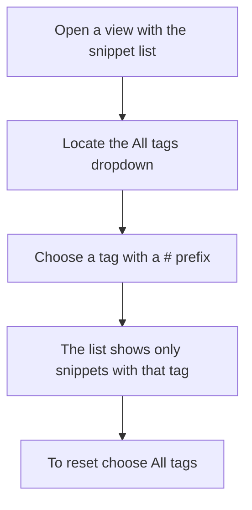
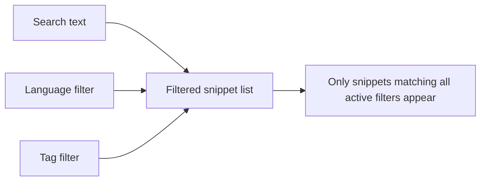

# How to filter snippets by tags

This guide shows you how to narrow your snippet library to only the snippets that share a specific tag. You can use this any time you've saved snippets with tags and want to focus on one topic, such as`#react` or`#utilities`.

> [!NOTE]
> The available tag choices come from the tags that are already attached to snippets in your workspace. If no snippets have tags yet, the tag filter list will be empty.

## Prerequisites

- You have at least one snippet in your workspace.
- At least one snippet has a tag. Tags appear as small`#` badges on snippet cards.
- You're on the **Dashboard**, **All Snippets**, **Favorites**, **Recently Added**, or **Recently Used** view, where the filter bar is visible.

## Steps to filter by tag

1. Locate the filter bar near the top of your snippet list.
2. Find the **All tags** dropdown, which sits alongside the language and category dropdowns.
3. Select the tag you want to see. Tags are listed with a`#` in front of the name, such as`#react` or`#api`.
4. The snippet list updates immediately to show only snippets that have the selected tag.

    Figure: Select a tag to narrow the snippet list

5. To see all snippets again, open the same dropdown and choose **All tags**.

## Combine with other filters

You can use the tag filter together with search and other dropdown filters to narrow results further. For example, choose`JavaScript` in the **All languages** dropdown and select`#utilities` in the tag dropdown to see JavaScript snippets tagged`#utilities`.

    Figure: Multiple filters narrow the list together

## Expected result

The snippet list shows a count such as`3 shown` for how many snippets match the selected tag. Every visible snippet card displays a matching`#tag` badge. Snippets that don't match are hidden, not deleted.

## Common issues

### The tag dropdown is empty
There are no snippets with tags in your workspace. Add tags to snippets through the **Tags** field in the snippet form, then open the tag dropdown again.

### Selecting a tag shows no results
The selected tag is active but no snippets match the current combination of filters. Broaden your search by clearing the search box or choosing **All languages** and **All categories**. If the list still shows no results, choose **All tags** to reset the tag filter.

### You don't recognize the tag choices
The tag dropdown lists only tags that are currently attached to snippets in your workspace. If a tag is no longer on any snippet, it won't appear in the dropdown.

## Next steps

- Learn how snippets, categories, and tags work together in [Concepts and Terminology](doc:0cccb845-62f3-4e2b-b0ca-c7d768eaf700)
- Find out how to organize snippets with categories and tags in [Snippet Organization](doc:8367ddb8-1051-4848-a093-3b4352805aa4)
- Explore other ways to find snippets in [Search and Filter](doc:3704cb56-cf68-421d-9db0-d3816a8af756)
- Learn how to favorite snippets and filter by favorites in [Favorites](doc:b66c5560-9b68-42eb-922d-a8aecab0dfcb)
