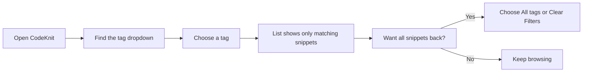

# How to filter snippets by tags

Filter your snippet library to show only snippets that carry a chosen tag.

## Prerequisites

- CodeKnit is open in your browser.
- At least one saved snippet has a tag. You add tags when you create or edit a snippet.

## Steps

1. Open CodeKnit and go to a page that lists snippets, such as **All Snippets** or **Dashboard**.
2. In the filter bar above the snippet list, find the tag dropdown. It shows **All tags** until you make a choice.
3. Click the tag dropdown and choose a tag from the list. Each tag appears with a`#` prefix, for example`#react` or`#python`.
4. Watch the snippet list update automatically. Only snippets that include the selected tag remain visible, and the **shown** count changes to match.
5. To see every snippet again, either choose **All tags** from the tag dropdown or click **Clear Filters**.

Figure: Tag filtering flow

> [!TIP]
> You can also find snippets by tag text by typing in the **Filter** or **Search** box. The search box accepts snippet titles, tags, and code text.

## Expected result

The snippet list shows only snippets that carry the selected tag, and the count labeled **shown** reflects the filtered result. Each visible snippet card displays its tags as small`#tag` chips.

## Common issues

- **A tag is missing from the dropdown.** The tag list is built from tags on your saved snippets. If no snippet uses a tag, that tag doesn't appear.
- **The list looks too narrow.** Tag filtering combines with search text and other filters such as language and category. A snippet must match every active filter to appear. Clear one or more filters to widen the results.
- **You can't find the tag dropdown.** It sits in the filter bar directly above the snippet cards, next to the language and category dropdowns.

## Related

- [Search and Filter](doc:3704cb56-cf68-421d-9db0-d3816a8af756)
- [Snippet Organization](doc:8367ddb8-1051-4848-a093-3b4352805aa4)
- [Your First Snippet – Quick Start](doc:72dab710-31b9-4980-becf-be9fbd6d4d94)
- [Snippet Library](doc:9f431e10-b005-4cc0-80b1-0af4acdcb3d8)
